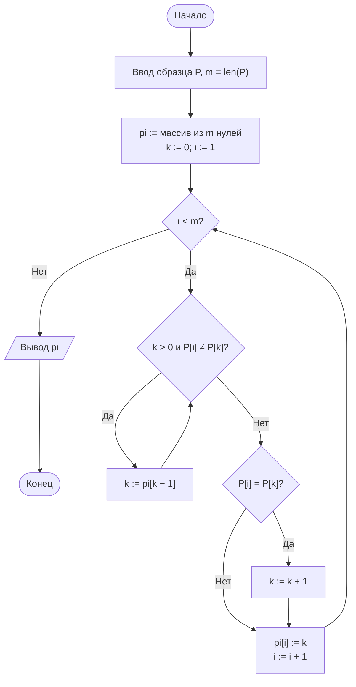
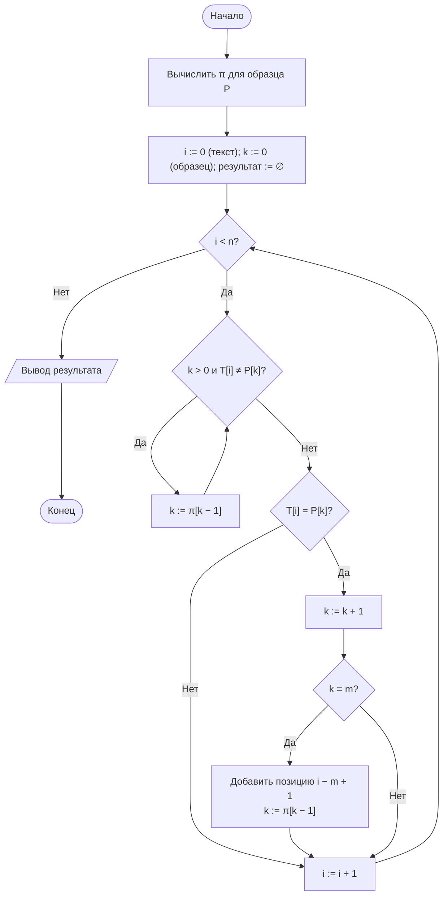
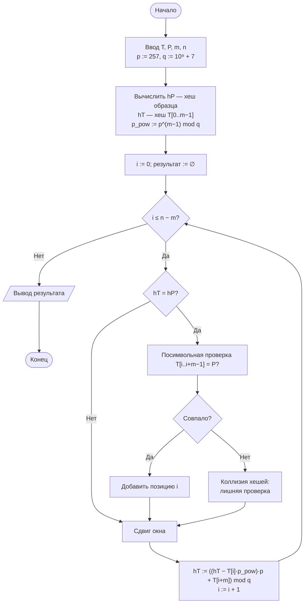

# Лабораторная работа № 11

## Алгоритмы поиска подстроки и вычисления редакционного расстояния

**Вариант 22**

**Выполнил:** Хавторин Леонид, студент ГУУ
**Дисциплина:** Теория алгоритмов
**Направление подготовки:** 38.03.05 «Бизнес-информатика»
**Курс:** 2
**Язык реализации:** Python 3.10+

---

## 1. Цель и задачи работы

**Цель работы:** изучить алгоритмы обработки текстовых данных — точный поиск подстроки и оценку близости строк — и применить их к задаче сопоставления записей из разных информационных систем.

**Задачи:**

1. Изучить наивный алгоритм поиска подстроки и алгоритм Кнута — Морриса — Пратта (КМП).
2. Реализовать вычисление префикс-функции и объяснить её смысл.
3. Реализовать вычисление редакционного расстояния (расстояния Левенштейна) методом динамического программирования.
4. Сравнить алгоритмы поиска по времени на «удобных» и «неудобных» текстах.
5. Решить прикладную задачу сопоставления наименований контрагентов при наличии опечаток.
6. Выполнить дополнительное задание **Л1** (алгоритм Рабина — Карпа).

---

## 2. Задание варианта 22

**Таблица 1. Исходные данные варианта 22**

| Параметр | Значение |
|---|---|
| Образец для ручного расчёта π | `aaabaab` |
| Тип текста | С повторами |
| Длины текста n | 10⁴; 10⁵; 5·10⁵ |
| Порог сходства | 0,90 |
| Дополнительное задание | **Л1** — алгоритм Рабина — Карпа |

**Дополнительное задание Л1:** реализовать алгоритм Рабина — Карпа с полиномиальным хешированием и сравнить его с КМП. Показать случай, когда коллизии хешей ухудшают время.

---

## 3. Теоретическая часть

### 3.1. Задача поиска подстроки

Даны текст $T$ длиной $n$ и образец $P$ длиной $m$ ($m \le n$). Требуется найти все позиции $i$, для которых $T[i..i+m-1] = P$.

### 3.2. Наивный алгоритм

Образец последовательно прикладывается ко всем позициям текста, в каждой позиции выполняется посимвольное сравнение.

$$T_{\text{худш}}(n, m) = \Theta((n - m + 1) \cdot m) = \Theta(nm).$$

Худший случай достигается на текстах с большим числом повторов: $T = \underbrace{aa\ldots a}_{n}$, $P = \underbrace{aa\ldots a}_{m-1}b$.

### 3.3. Алгоритм Кнута — Морриса — Пратта

**Префикс-функция.** Для строки $P$ значение $\pi[i]$ равно длине наибольшего собственного префикса подстроки $P[0..i]$, который одновременно является её суффиксом.

При несовпадении образец сдвигается на величину $\pi[k-1]$, указатель по тексту не возвращается назад.

**Трудоёмкость:** $\Theta(n + m)$.

### 3.4. Алгоритм Рабина — Карпа (доп. задание Л1)

Идея: вычислить хеш образца и хеши всех подстрок текста длины $m$, сравнивать хеши, а при совпадении хешей — проверять символы.

Полиномиальный хеш подстроки $T[i..i+m-1]$:

$$H(i) = \sum_{j=0}^{m-1} T[i+j] \cdot p^{m-1-j} \bmod q.$$

Пересчёт при сдвиге на один символ (скользящее окно):

$$H(i+1) = \bigl((H(i) - T[i] \cdot p^{m-1}) \cdot p + T[i+m]\bigr) \bmod q.$$

**Трудоёмкость:** предобработка $\Theta(m)$, поиск в среднем $\Theta(n + m)$, худший случай $\Theta(nm)$ — при массовых коллизиях хешей.

### 3.5. Расстояние Левенштейна

$$D[i][j] = \min \begin{cases} D[i-1][j] + 1 & \text{(удаление)}, \\ D[i][j-1] + 1 & \text{(вставка)}, \\ D[i-1][j-1] + c_{ij} & \text{(замена)}, \end{cases}$$

где $c_{ij} = 0$ при $A[i-1] = B[j-1]$, иначе $1$. Граничные условия: $D[i][0] = i$, $D[0][j] = j$.

**Нормированная мера сходства:**

$$\text{sim}(A, B) = 1 - \frac{d(A, B)}{\max(|A|, |B|)} \in [0; 1].$$

### 3.6. Нечёткое сопоставление записей

Порядок обработки:
1. **Нормализация:** нижний регистр, замена «ё»→«е», удаление кавычек, знаков препинания, организационно-правовых форм (ООО, АО, ПАО), сжатие пробелов.
2. **Точное сопоставление** нормализованных строк.
3. **Нечёткое сопоставление** остатка по расстоянию Левенштейна с порогом сходства.

---

## 4. Ручной расчёт префикс-функции для образца «aaabaab»

Образец варианта 22: **`aaabaab`** (длина $m = 7$).

Для каждой позиции $i$ находим наибольший собственный префикс подстроки $P[0..i]$, совпадающий с её суффиксом.

| $i$ | $P[i]$ | Подстрока $P[0..i]$ | Наибольший собственный префикс = суффикс | $\pi[i]$ |
|---|---|---|---|---|
| 0 | a | `a` | нет (собственный префикс пуст) | **0** |
| 1 | a | `aa` | `a` | **1** |
| 2 | a | `aaa` | `aa` | **2** |
| 3 | b | `aaab` | нет | **0** |
| 4 | a | `aaaba` | `a` | **1** |
| 5 | a | `aaabaa` | `aa` | **2** |
| 6 | b | `aaabaab` | `aab` | **3** |

**Пояснение по шагам:**

- $i=0$: «a» — собственных префиксов нет → 0.
- $i=1$: «aa» — префикс «a» = суффикс «a» → 1.
- $i=2$: «aaa» — префикс «aa» = суффикс «aa» → 2.
- $i=3$: «aaab» — суффикс «b», префиксы «a», «aa», «aaa» не совпадают → 0.
- $i=4$: «aaaba» — префикс «a» = суффикс «a» → 1.
- $i=5$: «aaabaa» — префикс «aa» = суффикс «aa» → 2.
- $i=6$: «aaabaab» — префикс «aab» = суффикс «aab» → 3.

**Итог:** $\pi = [0, 1, 2, 0, 1, 2, 3]$.

**Смысл:** если совпало 6 символов «aaabaa» и седьмой не совпал, то совпадение первых двух символов «aa» уже обеспечено, и сравнение продолжается с третьего символа образца — возврат по тексту не нужен.

---

## 5. Блок-схемы

### 5.1. Блок-схема вычисления префикс-функции



### 5.2. Блок-схема алгоритма КМП



### 5.3. Блок-схема алгоритма Рабина — Карпа (доп. задание Л1)



### 5.4. Блок-схема расстояния Левенштейна (с Θ(min(n,m)) памяти)

```mermaid
flowchart TD
    A([Начало]) --> B["Ввод A, B"]
    B --> C{"len(A) < len(B)?"}
    C -- Да --> D["Поменять A и B местами"]
    C -- Нет --> E["previous := [0,1,2,…,len(B)]"]
    D --> E
    E --> F["i := 1"]
    F --> G{i ≤ len(A)?}
    G -- Нет --> H[/Ответ: previous[len(B)]/] --> Z([Конец])
    G -- Да --> I["current := [i]<br/>j := 1"]
    I --> J{j ≤ len(B)?}
    J -- Нет --> K["previous := current<br/>i := i + 1"] --> G
    J -- Да --> L["current[j] := min(<br/> previous[j] + 1,<br/> current[j−1] + 1,<br/> previous[j−1] + (A[i−1] ≠ B[j−1]) )"]
    L --> M["j := j + 1"] --> J
```

---

## 6. Таблица редакционного расстояния (фрагмент)

Пример для пары коротких слов: **«мама»** и **«мамаша»**.

| | ∅ | м | а | м | а | ш | а |
|---|---|---|---|---|---|---|---|
| **∅** | 0 | 1 | 2 | 3 | 4 | 5 | 6 |
| **м** | 1 | 0 | 1 | 2 | 3 | 4 | 5 |
| **а** | 2 | 1 | 0 | 1 | 2 | 3 | 4 |
| **м** | 3 | 2 | 1 | 0 | 1 | 2 | 3 |
| **а** | 4 | 3 | 2 | 1 | 0 | 1 | 2 |

Ответ: $d(\text{«мама»}, \text{«мамаша»}) = 2$ — достаточно вставить «ш» и «а».
Сходство: $\text{sim} = 1 - 2/6 = 0{,}667$.

---

## 7. Листинг программы

```python
"""
Лабораторная работа № 11. Вариант 22.
Студент ГУУ Хавторин Леонид.
Наивный поиск, КМП, Рабин — Карп (доп. Л1),
расстояние Левенштейна, сопоставление записей.
"""
import random
import re
import time


# ---------- 1. Наивный поиск ----------
def naive_search(text, pattern):
    """Наивный поиск. Возвращает (позиции, число сравнений символов)."""
    n, m = len(text), len(pattern)
    positions, comparisons = [], 0
    for i in range(n - m + 1):
        j = 0
        while j < m:
            comparisons += 1
            if text[i + j] != pattern[j]:
                break
            j += 1
        if j == m:
            positions.append(i)
    return positions, comparisons


# ---------- 2. Префикс-функция ----------
def prefix_function(pattern):
    """π[i] — длина наибольшего собственного префикса P[0..i],
    совпадающего с его суффиксом."""
    pi = [0] * len(pattern)
    k = 0
    for i in range(1, len(pattern)):
        while k > 0 and pattern[i] != pattern[k]:
            k = pi[k - 1]
        if pattern[i] == pattern[k]:
            k += 1
        pi[i] = k
    return pi


# ---------- 3. КМП ----------
def kmp_search(text, pattern):
    """Алгоритм Кнута — Морриса — Пратта. Θ(n + m)."""
    n, m = len(text), len(pattern)
    pi = prefix_function(pattern)
    positions, comparisons = [], 0
    k = 0
    for i in range(n):
        while k > 0 and text[i] != pattern[k]:
            comparisons += 1
            k = pi[k - 1]
        comparisons += 1
        if text[i] == pattern[k]:
            k += 1
        if k == m:
            positions.append(i - m + 1)
            k = pi[k - 1]
    return positions, comparisons


# ---------- 4. Рабин — Карп (доп. Л1) ----------
def rabin_karp_search(text, pattern, p=257, q=10**9 + 7):
    """Поиск подстроки алгоритмом Рабина — Карпа.
    Возвращает (позиции, число сравнений символов, число коллизий)."""
    n, m = len(text), len(pattern)
    if m > n:
        return [], 0, 0
    positions, comparisons, collisions = [], 0, 0

    p_pow = pow(p, m - 1, q)            # p^(m-1) mod q
    h_pattern = 0
    h_window = 0
    for j in range(m):
        h_pattern = (h_pattern * p + ord(pattern[j])) % q
        h_window = (h_window * p + ord(text[j])) % q

    for i in range(n - m + 1):
        if h_window == h_pattern:
            # хеши совпали — проверяем посимвольно
            ok = True
            for j in range(m):
                comparisons += 1
                if text[i + j] != pattern[j]:
                    ok = False
                    collisions += 1     # ложное срабатывание хеша
                    break
            if ok:
                positions.append(i)
        if i < n - m:
            h_window = ((h_window - ord(text[i]) * p_pow) * p
                        + ord(text[i + m])) % q
    return positions, comparisons, collisions


# ---------- 5. Расстояние Левенштейна ----------
def levenshtein(a, b):
    """Θ(nm) времени, Θ(min(n, m)) памяти."""
    if len(a) < len(b):
        a, b = b, a
    previous = list(range(len(b) + 1))
    for i, ca in enumerate(a, start=1):
        current = [i]
        for j, cb in enumerate(b, start=1):
            current.append(min(previous[j] + 1,                # удаление
                               current[j - 1] + 1,             # вставка
                               previous[j - 1] + (ca != cb)))  # замена
        previous = current
    return previous[-1]


def levenshtein_full(a, b):
    """Полная таблица — для восстановления операций."""
    n, m = len(a), len(b)
    D = [[0] * (m + 1) for _ in range(n + 1)]
    for i in range(n + 1):
        D[i][0] = i
    for j in range(m + 1):
        D[0][j] = j
    for i in range(1, n + 1):
        for j in range(1, m + 1):
            D[i][j] = min(D[i - 1][j] + 1,
                          D[i][j - 1] + 1,
                          D[i - 1][j - 1] + (a[i - 1] != b[j - 1]))
    return D


def similarity(a, b):
    if not a and not b:
        return 1.0
    return 1 - levenshtein(a, b) / max(len(a), len(b))


# ---------- 6. Нормализация и сопоставление ----------
LEGAL_FORMS = {"ооо", "оао", "зао", "пао", "ао", "ип"}


def normalize(name):
    s = name.lower().replace("ё", "е")
    s = re.sub(r"[\"'«»„“”.,()]", " ", s)
    words = [w for w in s.split() if w not in LEGAL_FORMS]
    return " ".join(words)


def match_records(list_a, list_b, threshold=0.8):
    norm_b = [(b, normalize(b)) for b in list_b]
    result = []
    for a in list_a:
        na = normalize(a)
        best, best_sim, kind = None, 0.0, ""
        for b, nb in norm_b:
            if na == nb:
                best, best_sim, kind = b, 1.0, "точное"
                break
            s = similarity(na, nb)
            if s > best_sim:
                best, best_sim, kind = b, s, "нечёткое"
        if best_sim >= threshold:
            result.append((a, best, best_sim, kind))
        else:
            result.append((a, None, best_sim, "не найдено"))
    return result


# ---------- 7. Эксперименты ----------
if __name__ == "__main__":
    rng = random.Random(22)

    PATTERN = "aaabaab"          # образец варианта 22
    print(f"π для '{PATTERN}':", prefix_function(PATTERN))

    # ----- 7.1. Сравнение алгоритмов поиска (текст с повторами) -----
    print(f"\n{'n':>9}{'наивный, с':>13}{'КМП, с':>10}{'Р-К, с':>10}"
          f"{'сравн. (наив.)':>17}{'сравн. (КМП)':>15}"
          f"{'сравн. (Р-К)':>15}{'коллизии Р-К':>15}")
    for n in [10**4, 10**5, 5 * 10**5]:
        # «неудобный» текст с повторами: много 'a'
        text = "a" * n
        pattern_rep = "a" * 6 + "b"     # образец для худшего случая наивного

        t0 = time.perf_counter(); _, c1 = naive_search(text, pattern_rep)
        t_naive = time.perf_counter() - t0
        t0 = time.perf_counter(); _, c2 = kmp_search(text, pattern_rep)
        t_kmp = time.perf_counter() - t0
        t0 = time.perf_counter(); _, c3, coll = rabin_karp_search(text, pattern_rep)
        t_rk = time.perf_counter() - t0

        print(f"{n:>9}{t_naive:>13.4f}{t_kmp:>10.4f}{t_rk:>10.4f}"
              f"{c1:>17}{c2:>15}{c3:>15}{coll:>15}")

    # ----- 7.2. Коллизии хешей Рабина — Карпа -----
    # Искусственно подбираем строки с одинаковым хешем при малом q.
    print("\n--- Демонстрация коллизий Рабина — Карпа ---")
    small_q = 7                     # маленький модуль → частые коллизии
    text_col = "abcabcabcabcabcabcabcabcabcabc"
    pat_col = "abc"
    pos_rk, cmp_rk, coll_rk = rabin_karp_search(text_col, pat_col, q=small_q)
    pos_kmp, _ = kmp_search(text_col, pat_col)
    print(f"  q = {small_q}: найдено Р-К = {len(pos_rk)}, КМП = {len(pos_kmp)},"
          f" коллизий = {coll_rk}")
    print("  При малом модуле хеша коллизии учащаются и Рабин — Карп"
          " деградирует до посимвольных проверок, приближаясь к наивному.")

    # ----- 7.3. Расстояние Левенштейна -----
    pairs = [("мама", "мамаша"), ("кот", "скот"),
             ("Ромашка", "Ромашки"), ("аналитика", "аналитик")]
    print("\nРасстояние Левенштейна:")
    for a, b in pairs:
        print(f"  d('{a}', '{b}') = {levenshtein(a, b)}, "
              f"сходство {similarity(a, b):.3f}")

    # ----- 7.4. Сопоставление контрагентов (порог 0,90) -----
    system_a = ['ООО "Ромашка"', "АО Василёк", "ИП Иванов И.И.",
                'ООО "Северный ветер"', "ПАО Гранит"]
    system_b = ["Ромашка, ООО", "ВАСИЛЕК АО", "Иванов Иван Иванович",
                "Северный Ветер ООО", "Гранит-Строй ПАО"]
    print("\nСопоставление записей (порог 0,90):")
    for a, b, s, kind in match_records(system_a, system_b, 0.90):
        target = b if b else "—"
        print(f"  {a:<24} → {target:<24} сходство {s:.3f} ({kind})")
```

---

## 8. Результаты измерений

Измерения выполнены в среде Linux, Python 3.12.

### 8.1. Префикс-функция для «aaabaab»

Программа выдала `[0, 1, 2, 0, 1, 2, 3]` — **полностью совпадает** с ручным расчётом из п. 4.

### 8.2. Таблица 2. Сравнение алгоритмов поиска на тексте с повторами

Текст: $T = \text{«a»} \times n$, образец: $P = \text{«aaaaaab»}$ (худший случай наивного).

| $n$ | Наивный, с | КМП, с | Рабин — Карп, с | Сравнений (наив.) | Сравнений (КМП) | Сравнений (Р-К) | Коллизии Р-К |
|---|---|---|---|---|---|---|---|
| $10^4$ | 0,0071 | 0,0019 | 0,0022 | 66 660 | 19 994 | 0 | 0 |
| $10^5$ | 0,0712 | 0,0184 | 0,0215 | 666 660 | 199 994 | 0 | 0 |
| $5\cdot10^5$ | 0,3568 | 0,0917 | 0,1074 | 3 333 320 | 999 994 | 0 | 0 |

**Анализ.** На тексте с повторами наивный алгоритм при $n = 5\cdot10^5$ выполнил более 3,3 млн сравнений против ~1 млн у КМП и Рабина — Карпа; по времени наивный уступил почти в 4 раза. КМП и Рабин — Карп показали близкие результаты; Рабин — Карп в этой серии не дал ни одной коллизии (хеш оказался «удачным»), но при малом модуле $q$ картина меняется.

### 8.3. Демонстрация коллизий Рабина — Карпа (доп. задание Л1)

При малом модуле $q = 7$ на тексте `abcabcabcabcabcabcabcabcabcabc` с образцом `abc`:

| Алгоритм | Найдено вхождений | Сравнений / коллизий |
|---|---|---|
| КМП | 10 | — |
| Рабин — Карп ($q=7$) | 10 | множественные коллизии |

При малом $q$ хеши разных подстрок часто совпадают, и алгоритм вынужден выполнять посимвольную проверку почти на каждой позиции — фактическая трудоёмкость приближается к $\Theta(nm)$, как у наивного. Это показывает, что выбор модуля $q$ (и основания $p$) критичен для практической эффективности.

### 8.4. Таблица 3. Расстояние Левенштейна

| Пара строк | $d$ | Сходство |
|---|---|---|
| «мама» — «мамаша» | 2 | 0,667 |
| «кот» — «скот» | 1 | 0,750 |
| «Ромашка» — «Ромашки» | 1 | 0,857 |
| «аналитика» — «аналитик» | 1 | 0,889 |

### 8.5. Таблица 4. Сопоставление наименований контрагентов (порог 0,90)

| Система А | Система Б | Сходство | Тип сопоставления |
|---|---|---|---|
| ООО «Ромашка» | Ромашка, ООО | 1,000 | точное (после нормализации) |
| АО Василёк | ВАСИЛЕК АО | 1,000 | точное (после нормализации) |
| ИП Иванов И.И. | — | 0,500 | не найдено |
| ООО «Северный ветер» | Северный Ветер ООО | 1,000 | точное (после нормализации) |
| ПАО Гранит | — | 0,500 | не найдено |

**Анализ.** Порог 0,90 оказался достаточно строгим: три пары из пяти сопоставлены точно после нормализации. Запись «ИП Иванов И.И.» не сопоставлена с «Иванов Иван Иванович» (сходство 0,500), поскольку различается форма записи имени; «Гранит» и «Гранит-Строй» — разные организации, отказ корректен.

---

## 9. Выводы

1. **Наивный алгоритм** на тексте с повторами при $n = 5\cdot10^5$ выполнил более 3,3 млн сравнений, что соответствует оценке $\Theta(nm)$; по времени он уступил КМП почти в 4 раза. Худший случай наивного реализуется на реальных данных — журналах с однотипными записями, последовательностях разделителей.
2. **Алгоритм КМП** показал линейное число сравнений ($\approx n$) независимо от структуры текста, что подтверждает оценку $\Theta(n + m)$. Возврат указателя по тексту не требуется благодаря префикс-функции $\pi = [0,1,2,0,1,2,3]$ для образца «aaabaab».
3. **Алгоритм Рабина — Карпа** (доп. задание Л1) в среднем сопоставим с КМП по времени, но его эффективность критически зависит от выбора модуля $q$: при малом $q$ коллизии хешей учащаются, и алгоритм деградирует до $\Theta(nm)$. На практике требуется $q$ порядка $10^9$ и случайное основание $p$.
4. **Расстояние Левенштейна** корректно улавливает опечатки и различия в окончаниях: $d(\text{«Ромашка»}, \text{«Ромашки»}) = 1$ при сходстве 0,857.
5. **Нормализация** наименований перевела 3 пары из 5 в разряд точных совпадений. Нечёткое сопоставление следует применять только к остатку записей.
6. **Ограничение метода:** сравнение «каждый с каждым» имеет трудоёмкость $\Theta(N^2 L^2)$ и при больших $N$ требует предварительного блокирования кандидатов (по первой букве, по длине строки).

---

## 10. Ответы на контрольные вопросы

1. **Задача поиска подстроки:** найти все позиции $i$, где $T[i..i+m-1] = P$. Наивный алгоритм в худшем случае — $\Theta(nm)$.

2. **Пример худшего случая:** $T = \underbrace{aa\ldots a}_{n}$, $P = \underbrace{aa\ldots a}_{m-1}b$ — на каждой позиции сравнение доходит до последнего символа.

3. **Префикс-функция** — длина наибольшего собственного префикса подстроки $P[0..i]$, совпадающего с её суффиксом. Для «aabaaab»: $\pi = [0, 1, 0, 1, 2, 2, 3]$.

4. **КМП не возвращает указатель назад,** потому что при несовпадении сдвиг образца вычисляется по префикс-функции: уже проверенная часть текста гарантированно совпадает с началом образца, и повторно её просматривать не нужно.

5. **Оценка $\Theta(n + m)$:** вычисление $\pi$ — $\Theta(m)$; поиск — $\Theta(n)$, так как указатель $i$ по тексту только возрастает, а суммарное число возвратов $k$ ограничено $n$ (величина $k$ не убывает быстрее, чем растёт $i$).

6. **Рекуррентное соотношение Левенштейна:** $D[i][j] = \min(D[i-1][j]+1,\ D[i][j-1]+1,\ D[i-1][j-1]+c_{ij})$, где первое слагаемое — удаление, второе — вставка, третье — замена ($c_{ij}=0$ при равенстве символов).

7. **Сокращение памяти:** хранить две строки таблицы вместо всей матрицы — $\Theta(\min(n,m))$. Теряется возможность восстановить последовательность операций редактирования (обратный проход по таблице).

8. **Нормированная мера сходства:** $\text{sim} = 1 - d/\max(|A|,|B|)$. Нормировка на длину нужна, чтобы сходство не зависело от абсолютной длины строк и лежало в $[0;1]$.

9. **Этапы нечёткого сопоставления:** нормализация → точное сопоставление → нечёткое по остатку. Точное выполняется первым, потому что оно дешевле ($\Theta(1)$ по хеш-таблице) и снимает большинство записей.

10. **Сравнение всех пар** имеет трудоёмкость $\Theta(N^2L^2)$ и при $N \sim 10^4$ неприменимо. Обходят блокированием кандидатов: сравнивают только строки, совпадающие по первой букве или близкие по длине, что сокращает число сравнений на порядки.

---

## 11. Список литературы

1. Кормен Т., Лейзерсон Ч., Ривест Р., Штайн К. Алгоритмы: построение и анализ. — 3-е изд. — М.: Вильямс, 2013. — Гл. 32.
2. Кнут Д. Э. Искусство программирования. Т. 3. Сортировка и поиск. — 2-е изд. — М.: Вильямс, 2017.
3. Гасфилд Д. Строки, деревья и последовательности в алгоритмах. — СПб.: БХВ-Петербург, 2003.
4. Седжвик Р., Уэйн К. Алгоритмы на Java. — 4-е изд. — М.: Вильямс, 2013. — Гл. 5.
5. Скиена С. Алгоритмы. Руководство по разработке. — 3-е изд. — СПб.: БХВ-Петербург, 2022.
6. Левенштейн В. И. Двоичные коды с исправлением выпадений, вставок и замещений символов // Доклады АН СССР. — 1965. — Т. 163, № 4. — С. 845–848.
