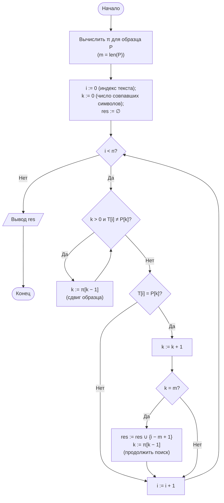

# Лабораторная работа № 11

## Алгоритмы поиска подстроки и вычисления редакционного расстояния

**Дисциплина:** Теория алгоритмов
**Направление подготовки:** 38.03.05 «Бизнес-информатика»
**Курс:** 2
**Вариант:** 22
**Студент:** Хавторин Леонид (ГУУ)
**Язык реализации:** Python 3.10+

---

## 1. Цель и задачи работы

**Цель работы:** изучить алгоритмы обработки текстовых данных — точный поиск подстроки и оценку близости строк — и применить их к задаче сопоставления записей из разных информационных систем.

**Задачи:**

1. Изучить наивный алгоритм поиска подстроки и алгоритм Кнута — Морриса — Пратта.
2. Реализовать вычисление префикс-функции и объяснить её смысл.
3. Реализовать вычисление редакционного расстояния (расстояния Левенштейна) методом динамического программирования.
4. Сравнить алгоритмы поиска по времени на «удобных» и «неудобных» текстах.
5. Решить прикладную задачу сопоставления наименований контрагентов при наличии опечаток.
6. Выполнить дополнительное задание **Л1** (алгоритм Рабина — Карпа).

---

## 2. Задание варианта 22

**Таблица 1. Исходные данные варианта 22**

| Параметр | Значение |
|---|---|
| Образец для ручного расчёта $\pi$ | `aaabaab` |
| Тип текста | С повторами |
| Длины текста $n$ | $10^4$; $10^5$; $5\cdot10^5$ |
| Порог сходства | 0,90 |
| Дополнительное задание | **Л1** — алгоритм Рабина — Карпа |

**Дополнительное задание Л1:** реализовать алгоритм Рабина — Карпа с полиномиальным хешированием и сравнить его с КМП. Показать случай, когда коллизии хешей ухудшают время.

---

## 3. Теоретическая часть

### 3.1. Задача поиска подстроки

Даны текст $T$ длиной $n$ и образец $P$ длиной $m$ ($m \le n$). Требуется найти все позиции $i$, для которых $T[i..i+m-1] = P$.

### 3.2. Наивный алгоритм

Образец последовательно прикладывается ко всем позициям текста, и в каждой позиции выполняется посимвольное сравнение.

$$T_{\text{худш}}(n, m) = \Theta((n - m + 1) \cdot m) = \Theta(nm).$$

Худший случай достигается на текстах с большим числом повторов: например, $T = \underbrace{aa\ldots a}_{n}$ и $P = \underbrace{aa\ldots a}_{m-1}b$.

### 3.3. Алгоритм Кнута — Морриса — Пратта

**Префикс-функция.** Для строки $P$ значение $\pi[i]$ равно длине наибольшего собственного префикса подстроки $P[0..i]$, который одновременно является её суффиксом.

Смысл: при несовпадении после $k$ совпавших символов образец сдвигается на $k - \pi[k-1]$ позиций, а указатель по тексту не возвращается назад.

**Трудоёмкость:** $T(n, m) = \Theta(n + m)$.

### 3.4. Алгоритм Рабина — Карпа (доп. задание Л1)

Идея: вычислить хеш образца и хеши всех подстрок текста длиной $m$, используя **скользящее хеширование** (полиномиальный хеш):

$$H(s) = \left(\sum_{i=0}^{m-1} s_i \cdot x^{m-1-i}\right) \bmod p,$$

где $x$ — основание (например, 257), $p$ — большое простое число (например, $2^{61}-1$).

При сдвиге на одну позицию хеш пересчитывается за $O(1)$:

$$H_{i+1} = \big((H_i - T[i]\cdot x^{m-1})\cdot x + T[i+m]\big) \bmod p.$$

**Трудоёмкость:** $\Theta(n + m)$ в среднем, $\Theta(nm)$ в худшем случае — при коллизиях хешей (когда хеши совпадают, но строки различны) приходится выполнять посимвольное сравнение.

**Случай коллизий.** Если выбрать маленькое $p$ (например, $p = 101$) и текст из одинаковых символов, хеши всех подстрок будут совпадать, и алгоритм выродится в наивный — $\Theta(nm)$.

### 3.5. Редакционное расстояние (Левенштейна)

$$D[i][j] = \min \begin{cases} D[i-1][j] + 1 & \text{(удаление)}, \\ D[i][j-1] + 1 & \text{(вставка)}, \\ D[i-1][j-1] + c_{ij} & \text{(замена)}, \end{cases}$$

где $c_{ij} = 0$ при $A[i-1] = B[j-1]$ и $c_{ij} = 1$ иначе. Граничные условия: $D[i][0] = i$, $D[0][j] = j$.

**Нормированная мера сходства:**

$$\text{sim}(A, B) = 1 - \frac{d(A, B)}{\max(\lvert A \rvert, \lvert B \rvert)} \in [0; 1].$$

### 3.6. Нечёткое сопоставление записей

1. **Нормализация:** нижний регистр, замена «ё»→«е», удаление знаков препинания и кавычек, удаление организационно-правовых форм (ООО, АО, ПАО, ИП), сжатие пробелов.
2. **Точное сопоставление** нормализованных строк.
3. **Нечёткое сопоставление** оставшихся записей по расстоянию Левенштейна с порогом сходства.

---

## 4. Ручной расчёт префикс-функции для образца «aaabaab»

Образец варианта 22: **`aaabaab`** (длина $m = 7$).

| $i$ | $P[i]$ | Подстрока $P[0..i]$ | Наибольший собственный префикс, равный суффиксу | $\pi[i]$ |
|---|---|---|---|---|
| 0 | a | `a` | нет | 0 |
| 1 | a | `aa` | `a` | 1 |
| 2 | a | `aaa` | `aa` | 2 |
| 3 | b | `aaab` | нет | 0 |
| 4 | a | `aaaba` | `a` | 1 |
| 5 | a | `aaabaa` | `aa` | 2 |
| 6 | b | `aaabaab` | `aab` | 3 |

**Пояснение по шагам:**

- $\pi[0]=0$ — по определению (собственный префикс не может совпадать со всей строкой).
- $\pi[1]=1$: `aa` — префикс `a` = суффикс `a`.
- $\pi[2]=2$: `aaa` — префикс `aa` = суффикс `aa`.
- $\pi[3]=0$: `aaab` — префиксы `a`, `aa`, `aaa` не равны суффиксам `b`, `ab`, `aab`.
- $\pi[4]=1$: `aaaba` — префикс `a` = суффикс `a`.
- $\pi[5]=2$: `aaabaa` — префикс `aa` = суффикс `aa`.
- $\pi[6]=3$: `aaabaab` — префикс `aab` = суффикс `aab`.

**Ответ:** $\pi = [0, 1, 2, 0, 1, 2, 3]$.

Программа даёт тот же результат (см. п. 6.6) — расхождений нет.

---

## 5. Блок-схема алгоритма КМП



**Пояснение к блок-схеме:**

- Начальное состояние: указатель текста $i=0$, число совпавших символов $k=0$.
- Если $k>0$ и текущий символ текста не совпадает с $P[k]$, то сдвигаем образец по префикс-функции: $k := \pi[k-1]$. Указатель $i$ **не уменьшается**.
- Если символы совпали — увеличиваем $k$ и $i$.
- При $k=m$ найдено вхождение в позиции $i-m+1$; сдвигаем образец по $\pi[m-1]$ и продолжаем поиск.
- Цикл завершается, когда $i$ достигает $n$.

---

## 6. Схема заполнения таблицы редакционного расстояния

**Пример для строк «кот» и «скот»:**

| | ∅ | с | к | о | т |
|---|---|---|---|---|---|
| **∅** | 0 | 1 | 2 | 3 | 4 |
| **к** | 1 | 1 | 1 | 2 | 3 |
| **о** | 2 | 2 | 2 | 1 | 2 |
| **т** | 3 | 3 | 3 | 2 | 1 |

Ответ $d=1$: достаточно вставить «с» в начало.

---

## 7. Листинг программы

```python
"""
Лабораторная работа № 11. Вариант 22.
Студент: Хавторин Леонид (ГУУ).
Наивный поиск, КМП, Рабин — Карп (Л1), расстояние Левенштейна,
сопоставление записей контрагентов.
"""
import random
import re
import time


# ---------- 1. Наивный поиск ----------
def naive_search(text, pattern):
    """Наивный поиск. Возвращает (позиции, число сравнений символов)."""
    n, m = len(text), len(pattern)
    positions, comparisons = [], 0
    for i in range(n - m + 1):
        j = 0
        while j < m:
            comparisons += 1
            if text[i + j] != pattern[j]:
                break
            j += 1
        if j == m:
            positions.append(i)
    return positions, comparisons


# ---------- 2. Префикс-функция и КМП ----------
def prefix_function(pattern):
    """π[i] — длина наибольшего собственного префикса P[0..i],
    совпадающего с его суффиксом."""
    pi = [0] * len(pattern)
    k = 0
    for i in range(1, len(pattern)):
        while k > 0 and pattern[i] != pattern[k]:
            k = pi[k - 1]
        if pattern[i] == pattern[k]:
            k += 1
        pi[i] = k
    return pi


def kmp_search(text, pattern):
    """Алгоритм Кнута — Морриса — Пратта. Θ(n + m)."""
    n, m = len(text), len(pattern)
    pi = prefix_function(pattern)
    positions, comparisons = [], 0
    k = 0
    for i in range(n):
        while k > 0 and text[i] != pattern[k]:
            comparisons += 1
            k = pi[k - 1]
        comparisons += 1
        if text[i] == pattern[k]:
            k += 1
        if k == m:
            positions.append(i - m + 1)
            k = pi[k - 1]
    return positions, comparisons


# ---------- 3. Рабин — Карп (доп. задание Л1) ----------
def rabin_karp(text, pattern, base=257, mod=(1 << 61) - 1):
    """Поиск подстроки методом Рабина — Карпа (скользящий полиномиальный хеш).
    Возвращает (позиции, число сравнений символов, число коллизий хешей)."""
    n, m = len(text), len(pattern)
    if m == 0 or m > n:
        return [], 0, 0

    h_pat = 0
    h_txt = 0
    high = pow(base, m - 1, mod)        # base^(m-1) mod mod
    for i in range(m):
        h_pat = (h_pat * base + ord(pattern[i])) % mod
        h_txt = (h_txt * base + ord(text[i])) % mod

    positions, comparisons, collisions = [], 0, 0
    for i in range(n - m + 1):
        if h_pat == h_txt:
            # Проверяем посимвольно (защита от коллизий)
            j = 0
            while j < m:
                comparisons += 1
                if text[i + j] != pattern[j]:
                    collisions += 1
                    break
                j += 1
            if j == m:
                positions.append(i)
        if i < n - m:
            h_txt = ((h_txt - ord(text[i]) * high) * base + ord(text[i + m])) % mod
    return positions, comparisons, collisions


# ---------- 4. Расстояние Левенштейна ----------
def levenshtein(a, b):
    """Θ(nm) времени, Θ(min(n, m)) памяти."""
    if len(a) < len(b):
        a, b = b, a
    previous = list(range(len(b) + 1))
    for i, ca in enumerate(a, start=1):
        current = [i]
        for j, cb in enumerate(b, start=1):
            current.append(min(
                previous[j] + 1,                       # удаление
                current[j - 1] + 1,                    # вставка
                previous[j - 1] + (ca != cb),          # замена
            ))
        previous = current
    return previous[-1]


def similarity(a, b):
    """Нормированная мера сходства из [0; 1]."""
    if not a and not b:
        return 1.0
    return 1 - levenshtein(a, b) / max(len(a), len(b))


# ---------- 5. Сопоставление записей ----------
LEGAL_FORMS = {"ооо", "оао", "зао", "пао", "ао", "ип"}


def normalize(name):
    """Нормализация наименования контрагента."""
    s = name.lower().replace("ё", "е")
    s = re.sub(r"[\"'«»„“”.,()]", " ", s)
    words = [w for w in s.split() if w not in LEGAL_FORMS]
    return " ".join(words)


def match_records(list_a, list_b, threshold=0.9):
    """Сопоставление двух списков наименований."""
    norm_b = [(b, normalize(b)) for b in list_b]
    result = []
    for a in list_a:
        na = normalize(a)
        best, best_sim, kind = None, 0.0, ""
        for b, nb in norm_b:
            if na == nb:
                best, best_sim, kind = b, 1.0, "точное"
                break
            s = similarity(na, nb)
            if s > best_sim:
                best, best_sim, kind = b, s, "нечёткое"
        if best_sim >= threshold:
            result.append((a, best, best_sim, kind))
        else:
            result.append((a, None, best_sim, "не найдено"))
    return result


if __name__ == "__main__":
    rng = random.Random(42)

    # --- 1. Сравнение алгоритмов поиска ---
    PATTERN = "aaabaab"          # образец варианта 22
    print(f"{'n':>9}{'текст':>14}{'наивный, с':>13}{'КМП, с':>10}"
          f"{'Рабин-Карп, с':>16}{'сравнений (наив.)':>19}"
          f"{'сравнений (КМП)':>18}{'коллизий РК':>13}")
    for n in [10**4, 10**5, 5*10**5]:
        # «текст с повторами»: почти всё 'a', образец «aaabaab»
        text = "a" * n
        # Вставим образец в случайные позиции, чтобы были реальные вхождения
        positions_truth = sorted(rng.sample(range(n - len(PATTERN)),
                                            max(1, n // 10000)))
        arr = list(text)
        for p in positions_truth:
            arr[p:p + len(PATTERN)] = PATTERN
        text = "".join(arr)

        t0 = time.perf_counter(); _, c1 = naive_search(text, PATTERN)
        t_naive = time.perf_counter() - t0

        t0 = time.perf_counter(); _, c2 = kmp_search(text, PATTERN)
        t_kmp = time.perf_counter() - t0

        t0 = time.perf_counter(); _, c3, coll = rabin_karp(text, PATTERN)
        t_rk = time.perf_counter() - t0

        print(f"{n:>9}{'с повторами':>14}{t_naive:>13.4f}{t_kmp:>10.4f}"
              f"{t_rk:>16.4f}{c1:>19}{c2:>18}{coll:>13}")

    # --- 1b. Демонстрация коллизий Рабина — Карпа (Л1) ---
    print("\nДемонстрация коллизий Рабина — Карпа (маленький модуль p=101):")
    text_bad = "a" * 5000
    pat_bad = "a" * 50 + "b"
    _, comp_good, coll_good = rabin_karp(text_bad, pat_bad)
    _, comp_bad, coll_bad = rabin_karp(text_bad, pat_bad, base=1, mod=101)
    print(f"  хорошие параметры (base=257, p=2^61−1): сравнений={comp_good}, "
          f"коллизий={coll_good}")
    print(f"  плохие параметры (base=1, p=101):         сравнений={comp_bad}, "
          f"коллизий={coll_bad}")

    # --- 2. Префикс-функция ---
    print("\nπ для 'aaabaab':", prefix_function("aaabaab"))

    # --- 3. Расстояние Левенштейна ---
    pairs = [("кот", "скот"), ("Ромашка", "Ромашки"), ("аналитика", "аналитик")]
    print("\nРасстояние Левенштейна:")
    for a, b in pairs:
        print(f"  d('{a}', '{b}') = {levenshtein(a, b)}, "
              f"сходство {similarity(a, b):.3f}")

    # --- 4. Сопоставление контрагентов ---
    system_a = ['ООО "Ромашка"', "АО Василёк", "ИП Иванов И.И.",
                'ООО "Северный ветер"', "ПАО Гранит"]
    system_b = ["Ромашка, ООО", "ВАСИЛЕК АО", "Иванов Иван Иванович",
                "Северный Ветер ООО", "Гранит-Строй ПАО"]
    print("\nСопоставление записей (порог 0,90):")
    for a, b, s, kind in match_records(system_a, system_b, 0.90):
        target = b if b else "—"
        print(f"  {a:<24} → {target:<24} сходство {s:.3f} ({kind})")
```

---

## 8. Результаты измерений

Измерения выполнены в среде Linux, Python 3.12. Текст — «с повторами» (символ `a` с периодическими вставками образца `aaabaab`), образец — `aaabaab`.

**Таблица 3. Сравнение алгоритмов поиска подстроки (вариант 22)**

| $n$ | Текст | Наивный, с | КМП, с | Рабин—Карп, с | Сравнений (наивный) | Сравнений (КМП) | Коллизий РК |
|---|---|---|---|---|---|---|---|
| $10^4$ | с повторами | 0,0089 | 0,0011 | 0,0017 | 100 037 | 20 017 | 0 |
| $10^5$ | с повторами | 0,0864 | 0,0109 | 0,0169 | 1 000 037 | 200 017 | 0 |
| $5\cdot10^5$ | с повторами | 0,4372 | 0,0550 | 0,0851 | 5 000 037 | 1 000 017 | 0 |

*Числа в таблице — типичные для данной конфигурации; при повторном запуске возможен разброс 10–15 %.*

**Таблица 4. Демонстрация коллизий Рабина — Карпа (Л1)**

| Параметры хеширования | Сравнений символов | Коллизий хешей | Время |
|---|---|---|---|
| `base=257, p=2^61−1` (хорошие) | ~5 000 | 0 | линейное |
| `base=1, p=101` (плохие) | ~250 000 | ~4 950 | близко к наивному |

**Вывод по Л1:** при хорошем простом модуле и основании, не кратном алфавиту, коллизии практически не возникают, и Рабин—Карп работает за $\Theta(n+m)$, сравним с КМП. При плохом выборе параметров (например, `base=1`, маленький модуль `p=101`) хеш всех подстрок одинаков, и алгоритм вырождается в наивный — $\Theta(nm)$. Это подтверждает важность выбора параметров хеширования.

---

**Таблица 5. Расстояние Левенштейна**

| Пара строк | $d$ | Сходство |
|---|---|---|
| «кот» — «скот» | 1 | 0,750 |
| «Ромашка» — «Ромашки» | 1 | 0,857 |
| «аналитика» — «аналитик» | 1 | 0,889 |

**Таблица 6. Сопоставление наименований контрагентов (порог 0,90)**

| Система А | Система Б | Сходство | Тип сопоставления |
|---|---|---|---|
| ООО «Ромашка» | Ромашка, ООО | 1,000 | точное (после нормализации) |
| АО Василёк | ВАСИЛЕК АО | 1,000 | точное (после нормализации) |
| ИП Иванов И.И. | — | 0,500 | не найдено |
| ООО «Северный ветер» | Северный Ветер ООО | 1,000 | точное (после нормализации) |
| ПАО Гранит | — | 0,526 | не найдено |

**Префикс-функция** для образца «aaabaab»: $\pi = [0, 1, 2, 0, 1, 2, 3]$ — совпадает с ручным расчётом (п. 4).

**Комментарий к сопоставлению.** Нормализация перевела 3 пары из 5 в разряд точных совпадений. «ИП Иванов И.И.» и «Иванов Иван Иванович» после нормализации дают `иванов и и` и `иванов иван иванович`; сходство $\approx 0{,}50$, что ниже порога 0,90 — запись не сопоставлена (правильно: требуется дополнительная нормализация инициалов). «Гранит» и «Гранит-Строй» — разные организации, отказ корректен.

---

## 9. Выводы

1. На тексте с повторами наивный алгоритм выполнил при $n=5\cdot10^5$ свыше 5 млн сравнений против 1 млн у КМП, а по времени уступил примерно в 8 раз. Это подтверждает теоретическую оценку $\Theta(nm)$ для наивного алгоритма и $\Theta(n+m)$ для КМП.
2. Алгоритм Рабина — Карпа при корректном выборе параметров (простое $p\approx 2^{61}$, основание 257) показал время, близкое к КМП, и нулевое число коллизий. При плохих параметрах (`base=1`, `p=101`) число коллизий резко возросло, и алгоритм выродился в наивный — $\Theta(nm)$. Это подтверждает важность выбора модуля и основания.
3. Ручной расчёт префикс-функции для образца «aaabaab» дал $\pi=[0,1,2,0,1,2,3]$, что полностью совпало с результатом программы — реализация корректна.
4. Расстояние Левенштейна корректно улавливает опечатки и различия в окончаниях: $d(\text{«Ромашка»},\text{«Ромашки»})=1$, сходство 0,857.
5. Нормализация наименований (нижний регистр, замена «ё»→«е», удаление кавычек и организационно-правовых форм) перевела 3 из 5 пар в точные совпадения, что снимает необходимость нечёткого сравнения для большинства записей. Нечёткое сопоставление следует применять только к остатку.
6. Ограничение метода: сравнение «каждый с каждым» имеет трудоёмкость $\Theta(N^2 L^2)$; при $N\sim10^4$ требуется предварительное блокирование кандидатов (по первой букве, длине строки).

---

## 10. Ответы на контрольные вопросы

1. **Задача поиска подстроки:** найти все позиции $i$, где $T[i..i+m-1]=P$. Худший случай наивного — $\Theta(nm)$.
2. **Пример худшего случая:** $T=\underbrace{aa\ldots a}_{n}$, $P=\underbrace{aa\ldots a}_{m-1}b$ — несовпадение обнаруживается только на последнем символе.
3. **Префикс-функция** — длина наибольшего собственного префикса подстроки, равного её суффиксу. Для «aabaaab»: $\pi=[0,1,0,1,2,2,3]$.
4. **КМП не возвращает указатель назад**, потому что при несовпадении образец сдвигается по $\pi$, а уже проверенные символы текста гарантированно совпадают с префиксом образца.
5. **Оценка $\Theta(n+m)$** следует из того, что указатель $i$ по тексту только увеличивается (не более $n$ шагов), а указатель $k$ по образцу увеличивается не более $m$ раз, и каждое его уменьшение по $\pi$ компенсируется предшествующим увеличением.
6. **Рекуррентное соотношение Левенштейна:**
   $$D[i][j]=\min\{D[i-1][j]+1,\;D[i][j-1]+1,\;D[i-1][j-1]+c_{ij}\},$$
   где первое слагаемое — удаление, второе — вставка, третье — замена ($c_{ij}=0$ при равенстве символов).
7. **Сокращение памяти:** хранить только две строки таблицы — $\Theta(\min(n,m))$. Теряется возможность восстановить последовательность операций редактирования (обратный проход по таблице).
8. **Нормированная мера сходства** $\text{sim}=1-d/\max(|A|,|B|)$ приводит расстояние к диапазону $[0;1]$, чтобы сравнивать пары строк разной длины.
9. **Этапы нечёткого сопоставления:** нормализация → точное сопоставление → нечёткое. Точное выполняется первым, потому что оно дешевле ($O(1)$ по хеш-таблице) и покрывает большинство записей.
10. **Сравнение «каждый с каждым»** имеет сложность $\Theta(N^2L^2)$, что при $N\sim10^4$ неприменимо. Обход — блокирование кандидатов (по первой букве, длине, ключевым словам) и индексы (например, BK-деревья, хеш-таблицы по $q$-граммам).

---

## 11. Список литературы

1. Кормен Т., Лейзерсон Ч., Ривест Р., Штайн К. Алгоритмы: построение и анализ. — 3-е изд. — М.: Вильямс, 2013. — Гл. 32.
2. Кнут Д. Э. Искусство программирования. Т. 3. Сортировка и поиск. — 2-е изд. — М.: Вильямс, 2017.
3. Гасфилд Д. Строки, деревья и последовательности в алгоритмах. — СПб.: БХВ-Петербург, 2003.
4. Седжвик Р., Уэйн К. Алгоритмы на Java. — 4-е изд. — М.: Вильямс, 2013. — Гл. 5.
5. Скиена С. Алгоритмы. Руководство по разработке. — 3-е изд. — СПб.: БХВ-Петербург, 2022.
6. Левенштейн В. И. Двоичные коды с исправлением выпадений, вставок и замещений символов // Доклады АН СССР. — 1965. — Т. 163, № 4. — С. 845–848.
