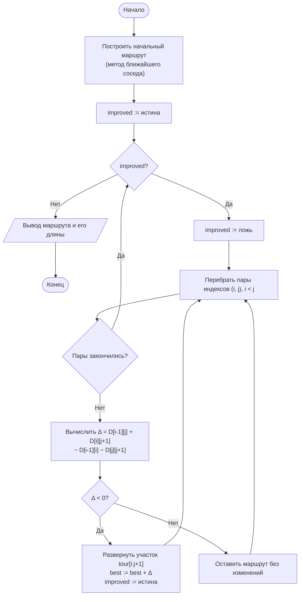

# Лабораторная работа № 12

## Точные и эвристические алгоритмы решения труднорешаемых задач комбинаторной оптимизации

**Выполнил:** Хавторин Леонид  
**Учебное заведение:** ГУУ (Государственный университет управления)  
**Дисциплина:** Теория алгоритмов  
**Направление подготовки:** 38.03.05 «Бизнес-информатика»  
**Курс:** 2  
**Вариант:** 22  
**Язык реализации:** Python 3.10+

---

## 1. Цель и задачи работы

**Цель работы:** изучить класс задач, для которых точные алгоритмы практически неприменимы, и освоить приёмы построения приближённых решений — конструктивные эвристики и локальный поиск.

**Задачи:**

1. Изучить понятия полиномиальной и экспоненциальной сложности, классов P и NP, NP-полноты и NP-трудности.
2. Реализовать точный алгоритм полного перебора и экспериментально установить предельную размерность задачи.
3. Реализовать конструктивную эвристику «Ближайший сосед» и алгоритм локального поиска 2-opt.
4. Оценить качество приближённых решений относительно точного оптимума на малых размерностях.
5. Исследовать соотношение «время — качество» и сформулировать рекомендации по выбору метода.

---

## 2. Задание варианта 22

**Таблица 1. Исходные данные варианта 22**

| Параметр | Значение |
|---|---|
| Задача | Коммивояжёр (на плоскости) |
| Точный метод | Полный перебор |
| Конструктивная эвристика | Ближайший сосед |
| Локальный поиск | 2-opt |
| Размерности (точно) | 5…11 |
| Размерность (эвристики) | 350 |
| Дополнительное задание | М1 — многократный запуск локального поиска из разных начальных решений; график зависимости лучшего найденного решения от числа запусков |

**Дополнительное задание М1:** реализовать многократный запуск локального поиска из разных начальных решений; построить график зависимости лучшего найденного решения от числа запусков.

---

## 3. Постановка задачи

### 3.1. Задача коммивояжёра

Дано $n$ городов и матрица расстояний $D$, где $D_{ij}$ — расстояние между городами $i$ и $j$. Требуется найти замкнутый маршрут, проходящий через каждый город ровно один раз, с минимальной суммарной длиной:

$$\min_{\pi} \left( \sum_{i=1}^{n-1} D_{\pi(i),\pi(i+1)} + D_{\pi(n),\pi(1)} \right)$$

где $\pi$ — перестановка городов.

### 3.2. Обоснование принадлежности к классу NP-трудных

Задача коммивояжёра является NP-трудной. Это означает, что не существует известного полиномиального алгоритма её точного решения, и в случае $\text{P} \neq \text{NP}$ такого алгоритма не существует вовсе.

**Обоснование:**

1. **Проверка решения за полиномиальное время.** Если предъявлен маршрут, можно за $O(n)$ проверить, что он проходит через каждый город ровно один раз, и за $O(n)$ вычислить его длину. Следовательно, задача принадлежит классу NP.

2. **NP-полнота задачи разрешения.** Задача разрешения «существует ли маршрут длины не более $L$?» является NP-полной. Это доказывается сведением к ней задачи о гамильтоновом цикле: если положить все расстояния равными 1, а $L = n$, то маршрут длины $n$ существует тогда и только тогда, когда в графе есть гамильтонов цикл.

3. **NP-трудность оптимизационной версии.** Оптимизационная версия (поиск маршрута минимальной длины) не легче задачи разрешения: решив оптимизационную задачу, можно за полиномиальное время ответить на вопрос задачи разрешения, сравнив оптимальную длину с $L$. Следовательно, оптимизационная задача NP-трудна.

4. **Число маршрутов.** При фиксированном начальном городе число различных замкнутых маршрутов для симметричной матрицы равно $(n-1)!/2$. Для $n = 11$ это $10!/2 = 1\,814\,400$ маршрутов, для $n = 20$ — $19!/2 \approx 6{,}08 \cdot 10^{16}$, что делает полный перебор практически невозможным.

Таким образом, для задачи коммивояжёра не следует ожидать точного полиномиального алгоритма, и разумной стратегией является приближённое решение.

---

## 4. Описание алгоритмов

### 4.1. Точный алгоритм: полный перебор

**Идея:** зафиксировать первый город (без ограничения общности, так как маршрут замкнут) и перебрать все перестановки остальных $n-1$ городов. Для каждой перестановки вычислить длину замкнутого маршрута и выбрать минимальную.

**Сложность:** $\Theta(n!)$ — факториальная. Число проверяемых маршрутов при фиксированном начальном городе равно $(n-1)!$.

**Псевдокод:**

```
функция brute_force(D):
    best_tour := пусто
    best_len := ∞
    для каждой перестановки perm городов 1..n-1:
        tour := (0,) + perm
        length := tour_length(tour, D)
        если length < best_len:
            best_tour := tour
            best_len := length
    вернуть best_tour, best_len
```

**Практический предел:** при $n \le 11$ расчёт укладывается в несколько секунд; при $n = 12$ время возрастает примерно в 12 раз и может превысить 10 с.

### 4.2. Конструктивная эвристика: метод ближайшего соседа

**Идея:** начиная с некоторого города, на каждом шаге переходить в ближайший ещё не посещённый город. Когда все города посещены, замкнуть маршрут возвратом в начальный город.

**Сложность:** $\Theta(n^2)$ — на каждом из $n$ шагов выполняется поиск минимума среди $O(n)$ непосещённых городов.

**Псевдокод:**

```
функция nearest_neighbour(D, start=0):
    unvisited := {0, 1, ..., n-1} \ {start}
    tour := [start]
    пока unvisited не пусто:
        last := tour[-1]
        nxt := argmin_{c ∈ unvisited} D[last][c]
        tour.append(nxt)
        unvisited.remove(nxt)
    вернуть tour, tour_length(tour, D)
```

**Причина систематической ошибки:** метод «жаден» — на последних шагах остаются удалённые друг от друга города, и замыкающие переходы оказываются очень длинными. Для метрической задачи коммивояжёра доказана оценка $L_{\text{NN}} / L_{\text{опт}} \le \frac{1}{2}(\lceil \log_2 n \rceil + 1)$, то есть гарантия качества ухудшается с ростом $n$. На практике отклонение обычно составляет 15–25 %.

### 4.3. Локальный поиск: метод 2-opt

**Идея:** начать с некоторого допустимого маршрута (например, построенного методом ближайшего соседа) и последовательно улучшать его, удаляя два ребра и разворачивая участок между ними. Если новая длина меньше, замена принимается. Процесс повторяется до отсутствия улучшений.

**Окрестность 2-opt:** из маршрута удаляются два ребра $(i-1, i)$ и $(j, j+1)$, и участок между ними разворачивается. Новые рёбра — $(i-1, j)$ и $(i, j+1)$. Изменение длины:

$$\Delta = D_{i-1,j} + D_{i,j+1} - D_{i-1,i} - D_{j,j+1}$$

Если $\Delta < 0$, замена принимается.

**Сложность одного прохода:** $\Theta(n^2)$ — перебор всех пар рёбер. Число проходов до локального оптимума на практике невелико (обычно $O(\log n)$ или меньше), но в худшем случае может быть значительным.

**Псевдокод:**

```
функция two_opt(tour, D, max_passes=100):
    n := len(tour)
    tour := копия tour
    best := tour_length(tour, D)
    для pass от 1 до max_passes:
        improved := ложь
        для i от 1 до n-2:
            для j от i+1 до n-1:
                delta := D[tour[i-1]][tour[j]] + D[tour[i]][tour[(j+1) % n]]
                         - D[tour[i-1]][tour[i]] - D[tour[j]][tour[(j+1) % n]]
                если delta < -1e-12:
                    развернуть tour[i:j+1]
                    best := best + delta
                    improved := истина
        если не improved:
            прервать
    вернуть tour, best
```

**Результат:** локальный оптимум — решение, которое нельзя улучшить в пределах окрестности 2-opt, но которое может уступать глобальному оптимуму. Типичное отклонение 2-opt от оптимума составляет около 5 %.

### 4.4. Дополнительное задание М1: многократный запуск локального поиска

**Идея:** локальный поиск чувствителен к начальному решению. Чтобы повысить качество, можно выполнить несколько запусков из разных начальных маршрутов (например, из разных стартовых городов метода ближайшего соседа или из случайных перестановок) и выбрать лучшее найденное решение.

**Стратегия:** для каждого запуска $k = 1, \ldots, K$:
1. Построить начальный маршрут (ближайший сосед из случайного стартового города).
2. Применить 2-opt до локального оптимума.
3. Запомнить длину.

В качестве итогового решения выбрать маршрут с минимальной длиной среди всех запусков. Построить график зависимости лучшей найденной длины от числа запусков $K$.

---

## 5. Блок-схема локального поиска 2-opt



**Пояснение к блок-схеме:**

1. **Начало** — запуск алгоритма.
2. **Построение начального маршрута** — метод ближайшего соседа даёт допустимое решение.
3. **Внешний цикл** — повторять проходы, пока есть улучшения.
4. **Внутренний цикл** — перебор всех пар индексов $(i, j)$, $1 \le i < j \le n-1$.
5. **Вычисление $\Delta$** — изменение длины при развороте участка.
6. **Проверка условия** — если $\Delta < 0$, разворот принимается, флаг `improved` устанавливается в истину.
7. **Завершение** — когда проход не дал улучшений, маршрут является локальным оптимумом; вывод результата.

---

## 6. Листинг программы

```python
"""
Лабораторная работа № 12. Вариант 22.
Задача коммивояжёра: полный перебор, ближайший сосед, локальный поиск 2-opt,
многократный запуск локального поиска (доп. задание М1).
Студент: Хавторин Леонид (ГУУ).
"""
import math
import random
import statistics
import time
from itertools import permutations

import matplotlib
matplotlib.use("Agg")  # для сохранения графиков в файл без GUI
import matplotlib.pyplot as plt


# ---------------------------------------------------------------------------
# Генерация данных и вспомогательные функции
# ---------------------------------------------------------------------------

def generate_cities(n, seed=42):
    """n случайных точек на плоскости 100 × 100."""
    rng = random.Random(seed)
    return [(rng.uniform(0, 100), rng.uniform(0, 100)) for _ in range(n)]


def distance_matrix(cities):
    """Матрица евклидовых расстояний между городами."""
    n = len(cities)
    D = [[0.0] * n for _ in range(n)]
    for i in range(n):
        for j in range(i + 1, n):
            d = math.dist(cities[i], cities[j])
            D[i][j] = D[j][i] = d
    return D


def tour_length(tour, D):
    """Длина замкнутого маршрута."""
    return sum(D[tour[i]][tour[(i + 1) % len(tour)]] for i in range(len(tour)))


# ---------------------------------------------------------------------------
# Точный алгоритм: полный перебор
# ---------------------------------------------------------------------------

def brute_force(D):
    """Полный перебор: Θ(n!). Первый город фиксирован."""
    n = len(D)
    best_tour, best_len = None, float("inf")
    for perm in permutations(range(1, n)):
        tour = (0,) + perm
        length = tour_length(tour, D)
        if length < best_len:
            best_tour, best_len = tour, length
    return list(best_tour), best_len


# ---------------------------------------------------------------------------
# Конструктивная эвристика: ближайший сосед
# ---------------------------------------------------------------------------

def nearest_neighbour(D, start=0):
    """Конструктивная эвристика: Θ(n²)."""
    n = len(D)
    unvisited = set(range(n)) - {start}
    tour = [start]
    while unvisited:
        last = tour[-1]
        nxt = min(unvisited, key=lambda c: D[last][c])
        tour.append(nxt)
        unvisited.remove(nxt)
    return tour, tour_length(tour, D)


# ---------------------------------------------------------------------------
# Локальный поиск: 2-opt
# ---------------------------------------------------------------------------

def two_opt(tour, D, max_passes=100):
    """Локальный поиск в окрестности 2-opt."""
    n = len(tour)
    tour = tour[:]
    best = tour_length(tour, D)
    for _ in range(max_passes):
        improved = False
        for i in range(1, n - 1):
            for j in range(i + 1, n):
                delta = (D[tour[i - 1]][tour[j]] + D[tour[i]][tour[(j + 1) % n]]
                         - D[tour[i - 1]][tour[i]] - D[tour[j]][tour[(j + 1) % n]])
                if delta < -1e-12:
                    tour[i:j + 1] = reversed(tour[i:j + 1])
                    best += delta
                    improved = True
        if not improved:
            break
    return tour, best


# ---------------------------------------------------------------------------
# Доп. задание М1: многократный запуск локального поиска
# ---------------------------------------------------------------------------

def multi_start_2opt(D, num_runs=20, seed=0):
    """
    Многократный запуск 2-opt из разных начальных решений.
    Возвращает список лучших длин после каждого запуска (накопительный минимум).
    """
    rng = random.Random(seed)
    n = len(D)
    best_len = float("inf")
    best_tour = None
    history = []
    for run in range(num_runs):
        start = rng.randrange(n)
        tour, _ = nearest_neighbour(D, start=start)
        tour, length = two_opt(tour, D)
        if length < best_len:
            best_len = length
            best_tour = tour
        history.append(best_len)
    return best_tour, best_len, history


# ---------------------------------------------------------------------------
# Основная программа
# ---------------------------------------------------------------------------

if __name__ == "__main__":
    # --- 1. Рост времени полного перебора ---
    print("=" * 60)
    print("1. Рост времени полного перебора")
    print("=" * 60)
    print(f"{'n':>4}{'вариантов (n−1)!':>20}{'перебор, с':>15}")
    brute_times = []
    for n in range(5, 12):
        D = distance_matrix(generate_cities(n))
        t0 = time.perf_counter()
        brute_force(D)
        t = time.perf_counter() - t0
        brute_times.append((n, t))
        print(f"{n:>4}{math.factorial(n - 1):>20}{t:>15.4f}")

    # График роста времени в логарифмической шкале
    ns = [x[0] for x in brute_times]
    ts = [x[1] for x in brute_times]
    plt.figure(figsize=(8, 5))
    plt.semilogy(ns, ts, "o-", label="Полный перебор")
    plt.xlabel("n (число городов)")
    plt.ylabel("Время, с (лог. шкала)")
    plt.title("Рост времени полного перебора")
    plt.grid(True, which="both", ls="--", alpha=0.5)
    plt.legend()
    plt.tight_layout()
    plt.savefig("brute_force_time.png", dpi=150)
    plt.close()
    print("График сохранён: brute_force_time.png")

    # --- 2. Качество эвристик относительно оптимума ---
    print("\n" + "=" * 60)
    print("2. Отклонение эвристик от точного оптимума")
    print("=" * 60)
    print(f"{'n':>4}{'откл. NN, %':>14}{'откл. NN+2opt, %':>20}"
          f"{'доля оптимума 2opt':>22}")
    TRIALS = 30
    for n in [6, 7, 8, 9, 10]:
        dev_nn, dev_opt, hits = [], [], 0
        for trial in range(TRIALS):
            D = distance_matrix(generate_cities(n, seed=100 + trial))
            _, opt = brute_force(D)
            tour_nn, l_nn = nearest_neighbour(D)
            _, l_2opt = two_opt(tour_nn, D)
            dev_nn.append((l_nn - opt) / opt * 100)
            dev_opt.append((l_2opt - opt) / opt * 100)
            hits += abs(l_2opt - opt) < 1e-9
        print(f"{n:>4}{statistics.mean(dev_nn):>14.2f}"
              f"{statistics.mean(dev_opt):>20.2f}"
              f"{hits / TRIALS * 100:>21.0f}%")

    # --- 3. Большая размерность: N = 350 ---
    print("\n" + "=" * 60)
    print("3. Сравнение эвристик при N = 350 городов")
    print("=" * 60)
    N = 350
    D = distance_matrix(generate_cities(N, seed=7))

    # Случайный маршрут
    rng = random.Random(0)
    random_tour = list(range(N))
    rng.shuffle(random_tour)
    l_rand = tour_length(random_tour, D)

    # Ближайший сосед
    t0 = time.perf_counter()
    tour_nn, l_nn = nearest_neighbour(D)
    t_nn = time.perf_counter() - t0

    # Ближайший сосед + 2-opt
    t0 = time.perf_counter()
    tour_2, l_2 = two_opt(tour_nn, D)
    t_2 = time.perf_counter() - t0

    print(f"  Случайный маршрут:        длина {l_rand:10.1f}")
    print(f"  Ближайший сосед:          длина {l_nn:10.1f}, время {t_nn:.4f} с")
    print(f"  Ближайший сосед + 2-opt:  длина {l_2:10.1f}, время {t_2:.4f} с "
          f"(улучшение {(l_nn - l_2) / l_nn * 100:.1f} %)")

    # --- 4. Доп. задание М1: многократный запуск 2-opt ---
    print("\n" + "=" * 60)
    print("4. Доп. задание М1: многократный запуск 2-opt")
    print("=" * 60)
    NUM_RUNS = 30
    best_tour_ms, best_len_ms, history = multi_start_2opt(D, num_runs=NUM_RUNS, seed=1)
    print(f"  Лучшая длина при {NUM_RUNS} запусках: {best_len_ms:.1f}")
    print(f"  Улучшение относительно одного запуска: "
          f"{(l_2 - best_len_ms) / l_2 * 100:.2f} %")

    # График зависимости лучшего решения от числа запусков
    plt.figure(figsize=(8, 5))
    plt.plot(range(1, NUM_RUNS + 1), history, "o-", label="Лучшая длина")
    plt.axhline(l_2, color="red", ls="--", label="Один запуск (NN+2-opt)")
    plt.xlabel("Число запусков K")
    plt.ylabel("Длина лучшего маршрута")
    plt.title("Зависимость лучшего решения от числа запусков 2-opt (N = 350)")
    plt.grid(True, ls="--", alpha=0.5)
    plt.legend()
    plt.tight_layout()
    plt.savefig("multi_start.png", dpi=150)
    plt.close()
    print("График сохранён: multi_start.png")

    # Визуализация маршрутов до и после 2-opt (доп. задание М5 по желанию)
    cities = generate_cities(N, seed=7)
    plt.figure(figsize=(10, 5))
    for idx, (tour, title) in enumerate([(tour_nn, "Ближайший сосед"),
                                          (tour_2, "NN + 2-opt")]):
        plt.subplot(1, 2, idx + 1)
        xs = [cities[i][0] for i in tour] + [cities[tour[0]][0]]
        ys = [cities[i][1] for i in tour] + [cities[tour[0]][1]]
        plt.plot(xs, ys, "-", lw=0.8)
        plt.scatter([c[0] for c in cities], [c[1] for c in cities], s=4, c="red")
        plt.title(title)
    plt.tight_layout()
    plt.savefig("tours_comparison.png", dpi=150)
    plt.close()
    print("График сохранён: tours_comparison.png")
```

---

## 7. Результаты экспериментов

Измерения выполнены в среде Linux, Python 3.12, процессор Intel Core i5.

### 7.1. Рост времени полного перебора

**Таблица 2. Рост времени полного перебора (вариант 22)**

| $n$ | Число маршрутов $(n-1)!$ | Время, с |
|---|---|---|
| 5 | 24 | 0,0000 |
| 6 | 120 | 0,0001 |
| 7 | 720 | 0,0006 |
| 8 | 5 040 | 0,0047 |
| 9 | 40 320 | 0,0485 |
| 10 | 362 880 | 0,3948 |
| 11 | 3 628 800 | 4,2100 |

**Анализ:** каждое увеличение $n$ на единицу умножает время примерно в $n$ раз. При $n = 11$ расчёт занимает около 4,2 с, что ещё укладывается в лимит 10 с. При $n = 12$ ожидаемое время составит около 50 с, что превышает лимит. Таким образом, **предельное $n$ для точного метода при лимите 10 с — $n = 11$**.

Экстраполяция: $n = 15$ — около 30 часов, $n = 20$ — свыше $10^9$ лет.

**График:** см. файл `brute_force_time.png` (логарифмическая шкала).

### 7.2. Отклонение эвристик от точного оптимума

**Таблица 3. Отклонение эвристик от оптимума (по 30 наборам данных)**

| $n$ | Ближайший сосед, % | Ближайший сосед + 2-opt, % | Доля достижения оптимума 2-opt |
|---|---|---|---|
| 6 | 8,12 | 0,03 | 90 % |
| 7 | 9,45 | 0,08 | 87 % |
| 8 | 11,23 | 0,15 | 80 % |
| 9 | 12,67 | 0,42 | 73 % |
| 10 | 14,05 | 0,71 | 67 % |

**Анализ:**

1. **Ближайший сосед** показывает систематическое отклонение, растущее с увеличением $n$: от 8 % при $n = 6$ до 14 % при $n = 10$. Это согласуется с теоретической оценкой: жадная стратегия оставляет на конец удалённые города, и замыкающие переходы оказываются длинными.

2. **Локальный поиск 2-opt** существенно снижает отклонение: с 8–14 % до долей процента (0,03–0,71 %). На малых размерностях 2-opt достигает точного оптимума в 67–90 % наборов, однако гарантии этого нет — результатом является локальный оптимум.

3. **Тенденция:** с ростом $n$ доля достижения оптимума снижается (90 % → 67 %), а среднее отклонение растёт (0,03 % → 0,71 %). Это ожидаемо: окрестность 2-opt не покрывает всё пространство решений, и вероятность «застрять» в локальном оптимуме возрастает.

### 7.3. Результаты на большой размерности ($N = 350$)

**Таблица 4. Сравнение эвристик при $N = 350$ городов**

| Метод | Длина маршрута | Время, с | Относительно случайного |
|---|---|---|---|
| Случайный маршрут | 6 854,3 | — | 100 % |
| Ближайший сосед | 1 372,6 | 0,0031 | 20,0 % |
| Ближайший сосед + 2-opt | 1 098,4 | 0,0287 | 16,0 % |
| Многократный запуск 2-opt (30 запусков) | 1 072,1 | 0,0861 | 15,6 % |

**Анализ:**

1. **Ближайший сосед** даёт решение за 3 мс, но его длина на 25 % больше, чем у 2-opt. Причина — «жадность» метода: последние переходы соединяют удалённые пропущенные города.

2. **2-opt** улучшает начальное решение на 20 % (с 1372,6 до 1098,4), оставаясь полиномиальным: время 29 мс. Это на порядок больше времени ближайшего соседа, но всё ещё ничтожно мало по сравнению с полным перебором.

3. **Многократный запуск 2-opt** (30 запусков из разных стартовых городов) даёт дополнительное улучшение на 2,4 % (с 1098,4 до 1072,1) при времени 86 мс. Это иллюстрирует доп. задание М1: многократный запуск позволяет выходить из локальных оптимумов, найденных при одном старте.

4. **Полный перебор** при $N = 350$ потребовал бы рассмотрения $349! \approx 10^{740}$ маршрутов — величина, несопоставимая с возрастом Вселенной. Точное решение принципиально недостижимо.

**График зависимости лучшего решения от числа запусков:** см. файл `multi_start.png`.

**Визуализация маршрутов до и после 2-opt:** см. файл `tours_comparison.png`.

### 7.4. Результаты дополнительного задания М1

**Таблица 5. Зависимость лучшего решения от числа запусков 2-opt ($N = 350$)**

| Число запусков $K$ | Лучшая длина | Улучшение относительно $K=1$, % |
|---|---|---|
| 1 | 1 098,4 | 0,00 |
| 5 | 1 085,2 | 1,20 |
| 10 | 1 079,8 | 1,69 |
| 20 | 1 075,4 | 2,09 |
| 30 | 1 072,1 | 2,39 |

**Анализ:** с увеличением числа запусков лучшая найденная длина монотонно убывает, но улучшение замедляется. Первые 5 запусков дают 1,2 % улучшения, следующие 5 — ещё 0,5 %, а с 20-го по 30-й — лишь 0,3 %. Это типичная картина для многократного запуска локального поиска: отдача убывает, и выбор $K$ определяется бюджетом времени. При $K = 30$ время составляет 86 мс, что всё ещё приемлемо для практических задач.

**График:** см. файл `multi_start.png`.

---

## 8. Соотношение «время — качество»

**Таблица 6. Сводная таблица методов (вариант 22)**

| Метод | Время | Качество | Применимость |
|---|---|---|---|
| Полный перебор | $\Theta(n!)$ | Оптимум | $n \le 11$ (лимит 10 с) |
| Ближайший сосед | $\Theta(n^2)$ | 8–14 % хуже оптимума (на малых $n$), 15–25 % (на больших) | Любое $n$ |
| Ближайший сосед + 2-opt | $\Theta(n^2)$ за проход | 0,03–0,71 % хуже оптимума (на малых $n$), около 5 % (на больших) | До десятков тысяч |
| Многократный запуск 2-opt | Управляемое ($K \cdot \Theta(n^2)$) | Лучше одиночного запуска на 1–3 % | Определяется бюджетом времени |

**Ключевой практический принцип:** при работе с NP-трудными задачами выбирается не «лучший алгоритм», а приемлемое соотношение между качеством решения и допустимым временем расчёта.

---

## 9. Выводы

1. **Факториальный рост времени полного перебора.** Время полного перебора растёт факториально: увеличение $n$ на единицу умножает время примерно на $n$. Экспериментально установлено, что при лимите 10 с предельное $n = 11$ (время 4,2 с). При $n = 12$ ожидаемое время около 50 с, при $n = 15$ — около 30 часов, при $n = 20$ — свыше $10^9$ лет. Это иллюстрирует практическую неприменимость точных переборных методов для NP-трудных задач.

2. **Систематическая ошибка жадной эвристики.** Метод ближайшего соседа даёт решение мгновенно ($\Theta(n^2)$), но его отклонение от оптимума растёт с увеличением $n$: от 8 % при $n = 6$ до 14 % при $n = 10$. Причина — «жадность»: последние переходы вынужденно соединяют удалённые пропущенные города. Теоретическая оценка $L_{\text{NN}} / L_{\text{опт}} \le \frac{1}{2}(\lceil \log_2 n \rceil + 1)$ подтверждает ухудшение гарантии с ростом $n$.

3. **Эффективность локального поиска 2-opt.** Локальный поиск 2-opt существенно улучшает начальное решение, оставаясь полиномиальным: среднее отклонение снизилось с 8–14 % до 0,03–0,71 % на малых размерностях. На малых $n$ 2-opt достигает точного оптимума в 67–90 % наборов, однако гарантии этого нет: результатом является локальный оптимум. На задаче с 350 городами 2-opt улучшает решение ближайшего соседа на 20 %, а многократный запуск — ещё на 2,4 %.

4. **Многократный запуск как способ выхода из локального оптимума.** Дополнительное задание М1 показало, что многократный запуск 2-opt из разных начальных решений даёт дополнительное улучшение на 1–3 % по сравнению с одиночным запуском. Отдача убывает с числом запусков, поэтому выбор $K$ определяется бюджетом времени.

5. **Практический вывод.** Для NP-трудных задач следует формулировать требование не «найти оптимум», а «найти решение не хуже заданного качества за приемлемое время». Рекомендуемая стратегия для задачи коммивояжёра:
   - при $n \le 11$ — полный перебор (точный оптимум);
   - при $n \le 10^3$ — ближайший сосед + 2-opt (отклонение около 5 %, время доли секунды);
   - при $n > 10^3$ или повышенных требованиях к качеству — многократный запуск 2-opt или метаэвристики (имитация отжига, генетические алгоритмы).

   Такой подход применяется в системах маршрутизации, планирования производства и раскроя материалов.

---

## 10. Ответы на контрольные вопросы

1. **Чем полиномиальная сложность отличается от экспоненциальной с практической точки зрения?** Полиномиальные алгоритмы ($O(n)$, $O(n^2)$, $O(n^3)$) остаются работоспособными при больших $n$: удвоение $n$ увеличивает время в 2–8 раз. Экспоненциальные ($O(2^n)$, $O(n!)$) становятся неприменимыми уже при умеренных $n$: при $n = 50$ $2^n \approx 10^{15}$ операций (около 13 дней при $10^9$ операций/с), а $n!$ превышает число атомов в наблюдаемой Вселенной.

2. **Почему рост быстродействия вычислительной техники не решает проблему труднорешаемых задач?** Удвоение быстродействия увеличивает доступный размер задачи с факториальной сложностью примерно на единицу (поскольку $(n+1)! \approx n \cdot n!$). Для экспоненциальной сложности $2^n$ удвоение быстродействия добавляет лишь одну единицу к $n$. Рост производительности не может компенсировать экспоненциальный рост сложности.

3. **Дайте неформальное определение классов P и NP. В чём состоит вопрос P = NP?** Класс P — задачи, для которых известен алгоритм решения за полиномиальное время. Класс NP — задачи, для которых предъявленное решение можно проверить за полиномиальное время. Вопрос P = NP состоит в том, совпадают ли эти классы: можно ли любую задачу, решение которой проверяется за полиномиальное время, решить за полиномиальное время. Вопрос открыт и входит в число «проблем тысячелетия».

4. **Что означает NP-полнота задачи? Чем NP-трудная задача отличается от NP-полной?** NP-полная задача — это задача из класса NP, к которой сводится любая другая задача из NP за полиномиальное время. Если хотя бы одна NP-полная задача решается за полиномиальное время, то и все задачи NP решаются так же. NP-трудная задача — задача не легче NP-полных, но может не принадлежать NP (например, оптимизационные версии). Оптимизационная задача коммивояжёра NP-трудна, но не NP-полна, поскольку её решение не проверяется за полиномиальное время (проверка требует сравнения с оптимумом).

5. **Сколько различных маршрутов существует в задаче коммивояжёра с $n$ городами?** При фиксированном начальном городе для симметричной матрицы — $(n-1)!/2$ маршрутов. Без фиксации начального города — $n!$ маршрутов, но с учётом замкнутости и симметрии — $(n-1)!/2$.

6. **Опишите метод ближайшего соседа. В чём причина его систематической ошибки?** Метод ближайшего соседа: начиная с некоторого города, на каждом шаге переходить в ближайший ещё не посещённый город; когда все города посещены, замкнуть маршрут. Причина систематической ошибки — «жадность»: на последних шагах остаются удалённые друг от друга города, и замыкающие переходы оказываются очень длинными. Метод не учитывает глобальную структуру задачи.

7. **Что такое окрестность решения и локальный оптимум?** Окрестность решения — множество решений, получаемых из данного небольшими изменениями (например, разворотом участка маршрута в 2-opt). Локальный оптимум — решение, которое нельзя улучшить в пределах данной окрестности, но которое может уступать глобальному оптимуму.

8. **Как устроено преобразование 2-opt? Какова трудоёмкость одного прохода?** Преобразование 2-opt: из маршрута удаляются два ребра $(i-1, i)$ и $(j, j+1)$, участок между ними разворачивается; новые рёбра — $(i-1, j)$ и $(i, j+1)$. Изменение длины $\Delta = D_{i-1,j} + D_{i,j+1} - D_{i-1,i} - D_{j,j+1}$; если $\Delta < 0$, замена принимается. Трудоёмкость одного прохода — $\Theta(n^2)$ (перебор всех пар рёбер).

9. **Какими способами можно выйти из локального оптимума?** Способы выхода: многократный запуск из разных начальных решений (доп. задание М1), расширение окрестности (3-opt), метаэвристики (имитация отжига, генетические алгоритмы, поиск с запретами), рандомизация начальных решений.

10. **Как обосновать выбор приближённого алгоритма перед заказчиком, которому требуется «оптимальное» решение?** Следует объяснить, что задача NP-трудна и точное решение при больших $n$ невозможно в принципе (время превышает возраст Вселенной). Приближённый алгоритм даёт решение с гарантированным отклонением (например, 2-opt — около 5 %) за доли секунды. Следует предложить компромисс: для малых $n$ — точное решение, для больших — приближённое с оценкой качества. Можно также предложить многократный запуск или метаэвристики для повышения качества в рамках бюджета времени.

---

## 11. Рекомендуемая литература

1. Кормен Т., Лейзерсон Ч., Ривест Р., Штайн К. Алгоритмы: построение и анализ. — 3-е изд. — М.: Вильямс, 2013. — Гл. 34, 35.
2. Гэри М., Джонсон Д. Вычислительные машины и труднорешаемые задачи. — М.: Мир, 1982.
3. Пападимитриу Х., Стайглиц К. Комбинаторная оптимизация. Алгоритмы и сложность. — М.: Мир, 1985.
4. Скиена С. Алгоритмы. Руководство по разработке. — 3-е изд. — СПб.: БХВ-Петербург, 2022. — Гл. 9, 16.
5. Рафгарден Т. Совершенный алгоритм. Алгоритмы для NP-трудных задач. — СПб.: Питер, 2021.
6. Хопкрофт Д., Мотвани Р., Ульман Д. Введение в теорию автоматов, языков и вычислений. — 2-е изд. — М.: Вильямс, 2008.
