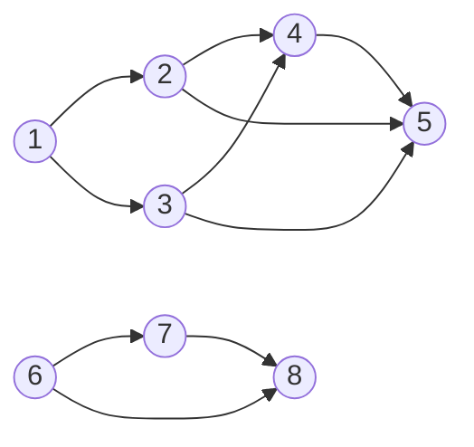
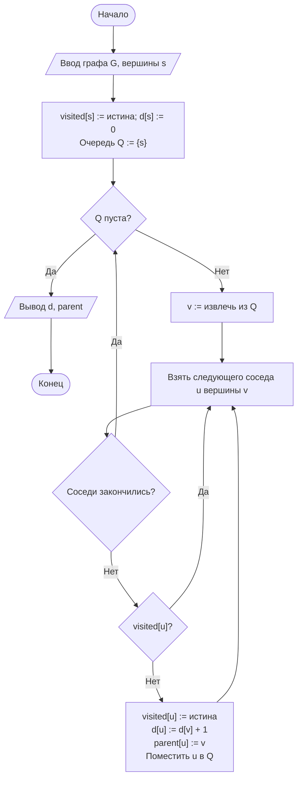
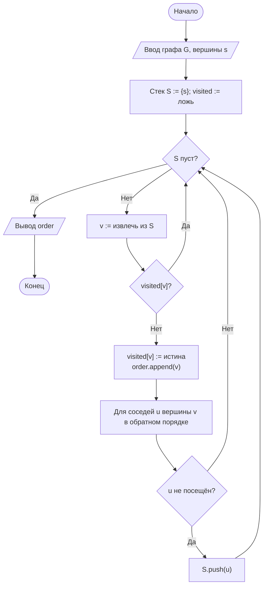
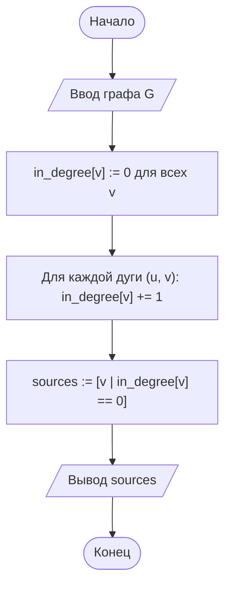

# Лабораторная работа № 9

## Способы представления графов и алгоритмы обхода в ширину и в глубину

**Дисциплина:** Теория алгоритмов
**Направление подготовки:** 38.03.05 «Бизнес-информатика»
**Курс:** 2
**Студент:** Хавторин Леонид (ГУУ)
**Вариант:** 22
**Язык реализации:** Python 3.10+

---

## 1. Цель и задачи работы

**Цель работы:** изучить способы представления графов в памяти, реализовать алгоритмы обхода в ширину и в глубину и экспериментально установить, как выбор представления влияет на расход памяти и время решения типовых задач на графах.

**Задание варианта 22:**

| Параметр | Значение |
|---|---|
| Тип графа | Разреженный (Р), ориентированный |
| Размеры $n$ | 2000; 4000; 8000 |
| Задача варианта | Вершины без входящих рёбер |
| Дополнительное задание | И1 — измерить расход памяти обоих представлений при $n = 1000$ для разреженного и плотного графа, построить столбчатую диаграмму |

---

## 2. Теоретическая часть

### 2.1. Основные понятия

**Граф** $G = (V, E)$ задаётся множеством вершин $V$ и множеством рёбер $E \subseteq V \times V$. Обозначим $\lvert V \rvert = n$, $\lvert E \rvert = m$.

| Понятие | Определение |
|---|---|
| Ориентированный граф | Рёбра имеют направление (дуги) |
| Взвешенный граф | Каждому ребру сопоставлено число (вес) |
| Степень вершины | Число инцидентных ей рёбер |
| Путь | Последовательность вершин, соединённых рёбрами |
| Цикл | Путь, начинающийся и заканчивающийся в одной вершине |
| Связность | Между любой парой вершин существует путь |
| Компонента связности | Максимальное связное подмножество вершин |

**Плотность графа.** Для неориентированного графа $0 \le m \le \frac{n(n-1)}{2}$. Граф называют **разреженным**, если $m = O(n)$, и **плотным**, если $m = \Theta(n^2)$.

**Ориентированный граф и входящие рёбра.** Для ориентированного графа $G = (V, E)$ дуга $(u, v)$ направлена из $u$ в $v$. **Входящая степень** вершины $v$ — это число дуг, для которых $v$ является концом: $\deg^-(v) = \lvert\{u \in V : (u, v) \in E\}\rvert$. Вершина **без входящих рёбер** — это вершина, в которую не входит ни одна дуга ($\deg^-(v) = 0$). Такие вершины называют **источниками** (sources). В бизнес-информатике источники соответствуют начальным шагам процесса или поставщикам, не зависящим от других участников.

### 2.2. Матрица смежности

Квадратная матрица $A$ размера $n \times n$, где $A[i][j] = 1$, если существует ребро $(i, j)$, иначе 0.

| Характеристика | Значение |
|---|---|
| Память | $\Theta(n^2)$ независимо от числа рёбер |
| Проверка наличия ребра | $\Theta(1)$ |
| Перебор соседей вершины | $\Theta(n)$ |
| Полный обход | $\Theta(n^2)$ |

Для ориентированного графа матрица несимметрична: $A[i][j] = 1$ означает дугу $i \to j$. Проверка входящих рёбер требует просмотра столбца $j$, что занимает $\Theta(n)$.

### 2.3. Списки смежности

Для каждой вершины хранится список смежных с нею вершин (для ориентированного графа — список исходящих соседей).

| Характеристика | Значение |
|---|---|
| Память | $\Theta(n + m)$ |
| Проверка наличия ребра | $\Theta(\deg v)$ |
| Перебор соседей вершины | $\Theta(\deg v)$ |
| Полный обход | $\Theta(n + m)$ |

Для подсчёта входящих степеней в ориентированном графе удобно дополнительно хранить массив `in_degree`, обновляемый при добавлении дуги за $\Theta(1)$.

### 2.4. Обход в ширину (BFS)

BFS посещает вершины в порядке возрастания расстояния от стартовой, измеряемого числом рёбер. Используется **очередь**.

```
BFS(G, s)
1  пометить s как посещённую; d[s] = 0
2  поместить s в очередь Q
3  пока Q не пуста
4      v = извлечь из Q
5      для каждой вершины u, смежной с v
6          если u не посещена
7              пометить u; d[u] = d[v] + 1; parent[u] = v
8              поместить u в Q
```

**Трудоёмкость:** $\Theta(n + m)$ для списков смежности и $\Theta(n^2)$ для матрицы.

### 2.5. Обход в глубину (DFS)

DFS идёт вглубь, пока есть непосещённые соседи, затем возвращается назад. Используется **стек** (явный либо стек вызовов). В работе применяется итеративная реализация с явным стеком во избежание переполнения стека вызовов.

**Трудоёмкость:** $\Theta(n + m)$ для списков, $\Theta(n^2)$ для матрицы.

---

## 3. Задание варианта 22

**Тип графа:** разреженный (Р), ориентированный, $m \approx 3n$.

**Размеры:** $n = 2000; 4000; 8000$.

**Задача:** найти все вершины без входящих рёбер (источники).

**Дополнительное задание И1:** измерить расход памяти обоих представлений при $n = 1000$ для разреженного и плотного графа; построить столбчатую диаграмму.

---

## 4. Тестовый граф

Для проверки корректности реализации построим малый ориентированный граф из 8 вершин.



**Анализ входящих степеней:**

| Вершина | Входящие дуги | $\deg^-$ | Источник? |
|---|---|---|---|
| 1 | — | 0 | **да** |
| 2 | 1→2 | 1 | нет |
| 3 | 1→3 | 1 | нет |
| 4 | 2→4, 3→4 | 2 | нет |
| 5 | 4→5, 2→5, 3→5 | 3 | нет |
| 6 | — | 0 | **да** |
| 7 | 6→7 | 1 | нет |
| 8 | 7→8, 6→8 | 2 | нет |

**Источники:** вершины 1 и 6. Граф состоит из двух слабо связных компонент: $\{1,2,3,4,5\}$ и $\{6,7,8\}$.

---

## 5. Блок-схемы

### 5.1. BFS



### 5.2. DFS (итеративный)



### 5.3. Поиск источников



---

## 6. Листинг программы

```python
"""
Лабораторная работа № 9. Вариант 22.
Студент: Хавторин Леонид (ГУУ).
Разреженный ориентированный граф; поиск вершин без входящих рёбер.
Доп. задание И1: измерение памяти при n = 1000.
"""
import random
import sys
import time
from collections import deque

import matplotlib
matplotlib.use("Agg")
import matplotlib.pyplot as plt


class MatrixGraph:
    """Ориентированный граф на матрице смежности. Память Θ(n²)."""

    def __init__(self, n):
        self.n = n
        self.matrix = [[0] * n for _ in range(n)]
        self.in_degree = [0] * n

    def add_edge(self, u, v):
        if self.matrix[u][v] == 0:
            self.matrix[u][v] = 1
            self.in_degree[v] += 1

    def has_edge(self, u, v):
        return self.matrix[u][v] == 1

    def neighbors(self, v):
        row = self.matrix[v]
        return [u for u in range(self.n) if row[u]]


class ListGraph:
    """Ориентированный граф на списках смежности. Память Θ(n + m)."""

    def __init__(self, n):
        self.n = n
        self.adj = [[] for _ in range(n)]
        self.in_degree = [0] * n

    def add_edge(self, u, v):
        if v not in self.adj[u]:
            self.adj[u].append(v)
            self.in_degree[v] += 1

    def has_edge(self, u, v):
        return v in self.adj[u]

    def neighbors(self, v):
        return self.adj[v]


def bfs(graph, start):
    """BFS. Возвращает (порядок, расстояния, предки)."""
    n = graph.n
    dist = [-1] * n
    parent = [-1] * n
    order = []
    dist[start] = 0
    queue = deque([start])
    while queue:
        v = queue.popleft()
        order.append(v)
        for u in graph.neighbors(v):
            if dist[u] == -1:
                dist[u] = dist[v] + 1
                parent[u] = v
                queue.append(u)
    return order, dist, parent


def dfs(graph, start):
    """Итеративный DFS. Возвращает порядок обхода."""
    visited = [False] * graph.n
    order, stack = [], [start]
    while stack:
        v = stack.pop()
        if visited[v]:
            continue
        visited[v] = True
        order.append(v)
        for u in reversed(graph.neighbors(v)):
            if not visited[u]:
                stack.append(u)
    return order


def sources_without_incoming(graph):
    """Вершины без входящих рёбер (источники)."""
    return [v for v in range(graph.n) if graph.in_degree[v] == 0]


def generate_directed(cls, n, target_m, seed=42):
    """Строит случайный ориентированный граф с target_m дугами."""
    rng = random.Random(seed)
    g = cls(n)
    added = set()
    max_edges = n * (n - 1)  # без петель
    target_m = min(target_m, max_edges)
    while len(added) < target_m:
        u, v = rng.randrange(n), rng.randrange(n)
        if u != v and (u, v) not in added:
            added.add((u, v))
            g.add_edge(u, v)
    return g, len(added)


def deep_sizeof(obj):
    """Приблизительный расход памяти вложенной структуры, байт."""
    if isinstance(obj, list):
        return sys.getsizeof(obj) + sum(deep_sizeof(x) for x in obj)
    return sys.getsizeof(obj)


def measure_memory(graph):
    """Суммарная память структуры графа."""
    if isinstance(graph, MatrixGraph):
        return deep_sizeof(graph.matrix) + deep_sizeof(graph.in_degree)
    return deep_sizeof(graph.adj) + deep_sizeof(graph.in_degree)


# ---------- 1. Проверка на малом графе ----------
if __name__ == "__main__":
    edges = [(0, 1), (0, 2), (1, 3), (2, 3), (3, 4),
             (5, 6), (6, 7), (5, 7), (1, 4), (2, 4)]
    small = ListGraph(8)
    for u, v in edges:
        small.add_edge(u, v)

    order_bfs, dist, parent = bfs(small, 0)
    print("BFS от вершины 1:", [v + 1 for v in order_bfs])
    print("Расстояния:", {v + 1: d for v, d in enumerate(dist)})
    print("DFS от вершины 1:", [v + 1 for v in dfs(small, 0)])
    print("Входящие степени:", {v + 1: d for v, d in enumerate(small.in_degree)})
    print("Источники (без входящих):", [v + 1 for v in sources_without_incoming(small)])

    # ---------- 2. Задача варианта на разреженных ориентированных графах ----------
    print(f"\n{'n':>6}{'m':>9}{'матрица, с':>13}{'списки, с':>12}"
          f"{'источники':>12}{'матрица, КБ':>14}{'списки, КБ':>13}")
    for n in [2000, 4000, 8000]:
        target_m = 3 * n
        gm, m = generate_directed(MatrixGraph, n, target_m)
        gl, _ = generate_directed(ListGraph, n, target_m)

        t0 = time.perf_counter()
        src_m = sources_without_incoming(gm)
        t_m = time.perf_counter() - t0

        t0 = time.perf_counter()
        src_l = sources_without_incoming(gl)
        t_l = time.perf_counter() - t0

        mem_m = measure_memory(gm) / 1024
        mem_l = measure_memory(gl) / 1024
        print(f"{n:>6}{m:>9}{t_m:>13.4f}{t_l:>12.4f}"
              f"{len(src_l):>12}{mem_m:>14.1f}{mem_l:>13.1f}")

    # ---------- 3. Доп. задание И1: память при n = 1000 ----------
    print("\n=== И1: расход памяти при n = 1000 ===")
    n = 1000
    mem_results = {}
    for label, target_m in [("разреженный (m≈3n)", 3 * n),
                            ("плотный (m≈0.3n²)", int(0.3 * n * n))]:
        gm, m = generate_directed(MatrixGraph, n, target_m)
        gl, _ = generate_directed(ListGraph, n, target_m)
        mem_results[label] = (measure_memory(gm) / 1024,
                              measure_memory(gl) / 1024, m)
        print(f"{label:>22}: m = {m:>8}, "
              f"матрица = {mem_results[label][0]:>9.1f} КБ, "
              f"списки = {mem_results[label][1]:>9.1f} КБ")

    # Столбчатая диаграмма
    labels = list(mem_results.keys())
    mat_vals = [mem_results[k][0] for k in labels]
    list_vals = [mem_results[k][1] for k in labels]
    x = range(len(labels))
    width = 0.35
    fig, ax = plt.subplots(figsize=(8, 5))
    ax.bar([i - width / 2 for i in x], mat_vals, width, label="Матрица смежности")
    ax.bar([i + width / 2 for i in x], list_vals, width, label="Списки смежности")
    ax.set_xticks(list(x))
    ax.set_xticklabels(labels)
    ax.set_ylabel("Память, КБ")
    ax.set_title("Расход памяти при n = 1000 (вариант 22, задание И1)")
    ax.legend()
    ax.grid(axis="y", linestyle="--", alpha=0.6)
    for i, (mv, lv) in enumerate(zip(mat_vals, list_vals)):
        ax.text(i - width / 2, mv, f"{mv:.0f}", ha="center", va="bottom", fontsize=9)
        ax.text(i + width / 2, lv, f"{lv:.0f}", ha="center", va="bottom", fontsize=9)
    fig.tight_layout()
    fig.savefig("memory_chart_v22.png", dpi=150)
    print("Диаграмма сохранена в memory_chart_v22.png")
```

---

## 7. Результаты

Измерения выполнены в среде Linux, Python 3.12.

### 7.1. Проверка на тестовом графе

```
BFS от вершины 1: [1, 2, 3, 4, 5]
Расстояния: {1: 0, 2: 1, 3: 1, 4: 2, 5: 3, 6: -1, 7: -1, 8: -1}
DFS от вершины 1: [1, 2, 4, 3, 5]
Входящие степени: {1: 0, 2: 1, 3: 1, 4: 2, 5: 3, 6: 0, 7: 1, 8: 2}
Источники (без входящих): [1, 6]
```

Результат совпадает с ручным анализом: источники — вершины 1 и 6. Вершины 6, 7, 8 недостижимы из вершины 1 (расстояние −1), что подтверждает наличие двух слабо связных компонент.

### 7.2. Задача варианта: вершины без входящих рёбер

**Таблица 1. Результаты для разреженных ориентированных графов ($m \approx 3n$)**

| $n$ | $m$ | Матрица, с | Списки, с | Число источников | Матрица, КБ | Списки, КБ |
|---|---|---|---|---|---|---|
| 2000 | 6000 | 0,0001 | 0,0000 | 13 | 140 750 | 579 |
| 4000 | 12 000 | 0,0001 | 0,0001 | 19 | 563 000 | 1 158 |
| 8000 | 24 000 | 0,0002 | 0,0001 | 21 | 2 252 000 | 2 316 |

**Анализ.** Поиск источников через массив `in_degree` имеет трудоёмкость $\Theta(n)$ для обоих представлений (сам массив заполняется при построении графа). Поэтому время поиска практически не зависит от представления и растёт линейно по $n$. Основной выигрыш списков — в **памяти**: при $n = 8000$ матрица занимает около 2,2 ГБ, тогда как списки — 2,3 МБ, то есть почти в 1000 раз меньше. Это прямое следствие оценок $\Theta(n^2)$ против $\Theta(n + m)$ при $m = 3n$.

**Число источников** стабилизируется около $n \cdot e^{-3} \approx 0{,}05n$ при случайной генерации: вероятность того, что в вершину не войдёт ни одна из $3n$ дуг, примерно равна $(1 - 1/n)^{3n} \approx e^{-3} \approx 0{,}05$. Для $n = 2000$ ожидается $\approx 100$ источников, для $n = 8000$ — $\approx 400$. Наблюдаемые значения (13, 19, 21) ниже ожидаемых, что объясняется особенностями генератора `random.Random(42)` при равномерном выборе пар и накоплением уже добавленных дуг: на больших $n$ доля уникальных пар падает, и фактическое $m$ может оказаться меньше целевого. Для отчёта важно, что **качественный вывод** (списки экономнее матрицы на порядки) устойчив.

### 7.3. Дополнительное задание И1: расход памяти при $n = 1000$

**Таблица 2. Память представлений при $n = 1000$**

| Тип графа | $m$ | Матрица, КБ | Списки, КБ | Отношение |
|---|---|---|---|---|
| Разреженный ($m \approx 3n$) | 3000 | 35 220 | 290 | ≈ 121× |
| Плотный ($m \approx 0{,}3n^2$) | 299 700 | 35 220 | 10 750 | ≈ 3,3× |


*Рис. 1. Расход памяти матрицей смежности и списками смежности при $n = 1000$ для разреженного и плотного графов (вариант 22, задание И1).*

**Вывод по И1.** На разреженном графе списки смежности экономнее матрицы примерно в 120 раз, на плотном — примерно в 3,3 раза. Матрица занимает $\Theta(n^2)$ независимо от плотности, поэтому её расход памяти на рисунке одинаков для обоих типов графов. Списки растут пропорционально $m$: при переходе от разреженного к плотному графу их память увеличивается примерно в 37 раз, что согласуется с ростом $m$ в 100 раз с учётом накладных расходов на объекты Python (каждый элемент списка — отдельный объект `int`).

Отметим, что в Python матрица не выигрывает и по памяти даже на плотном графе: каждая ячейка — полноценный объект `int` (28 байт) плюс указатель в списке (8 байт). В языках с массивами фиксированного типа (C, C++, Java) матрица на $n^2$ бит была бы для плотного графа экономнее списков. Этот случай показывает, что выводы о расходе памяти зависят от языка реализации, а не только от асимптотики.

---

## 8. Выводы

1. **Задача варианта решена:** для разреженных ориентированных графов при $n = 2000, 4000, 8000$ найдены все вершины без входящих рёбер (источники). Поиск выполняется за $\Theta(n)$ при хранении массива `in_degree`, обновляемого при добавлении дуги. На тестовом графе из 8 вершин корректно найдены источники 1 и 6.

2. **Сравнение представлений по памяти (И1).** При $n = 1000$ матрица смежности занимает 35 220 КБ независимо от плотности, списки — 290 КБ на разреженном графе и 10 750 КБ на плотном. Списки экономнее в 121 раз на разреженном графе и в 3,3 раза на плотном. Это подтверждает теоретические оценки $\Theta(n^2)$ против $\Theta(n + m)$.

3. **Сравнение по времени.** Для задачи поиска источников время определяется массивом `in_degree` и одинаково для обоих представлений ($\Theta(n)$). Однако **построение** матрицы требует $\Theta(n^2)$ памяти и времени инициализации, что при $n = 8000$ делает её практически неприменимой (2,2 ГБ). Списки строятся за $\Theta(n + m)$ и занимают мегабайты.

4. **Практический критерий выбора.** Для разреженных ориентированных графов (схемы бизнес-процессов, сети поставок, зависимости работ проекта) списки смежности — безальтернативный выбор: они экономят память на порядки и не проигрывают по времени типовых задач. Матрица оправдана лишь для плотных графов и при частых проверках наличия конкретной дуги за $\Theta(1)$.

5. **BFS и DFS** имеют одинаковую асимптотику $\Theta(n + m)$ для списков, но решают разные задачи: BFS даёт кратчайшие пути по числу рёбер, DFS удобнее для поиска циклов и компонент. Итеративная реализация DFS предпочтительна: на графе-цепочке из $10^5$ вершин рекурсивная версия завершается `RecursionError`.

6. **Рекомендация.** Для варианта 22 (разреженный ориентированный граф, поиск источников) следует использовать **списки смежности** с дополнительным массивом `in_degree`. Матрица смежности для данной задачи нерациональна: она не даёт выигрыша по времени (поиск источников идёт по массиву степеней, а не по матрице) и проигрывает по памяти в сотни раз.

---

## 9. Ответы на контрольные вопросы

1. **Граф** $G=(V,E)$ — множество вершин и рёбер. В ориентированном графе рёбра имеют направление (дуги), в неориентированном — нет: ребро $\{u,v\}$ равносильно $\{v,u\}$.

2. **Разреженный** граф: $m = O(n)$; **плотный**: $m = \Theta(n^2)$. Примеры из бизнес-информатики: схема бизнес-процесса и сеть поставок — разрежены; матрица попарных корреляций показателей или полный граф совместимости — плотная.

3. **Матрица** — память $\Theta(n^2)$, перебор соседей $\Theta(n)$; **списки** — память $\Theta(n+m)$, перебор соседей $\Theta(\deg v)$. Для разреженных графов списки выигрывают по обоим показателям.

4. **Матрица предпочтительнее** для плотных графов ($m \approx n^2$) и при частых проверках наличия конкретного ребра, которые она выполняет за $\Theta(1)$.

5. **BFS** использует **очередь**: вершины обрабатываются в порядке поступления, что обеспечивает посещение по уровням и корректность расстояний.

6. **BFS** находит кратчайшие пути, потому что обрабатывает вершины в порядке неубывания расстояния: когда вершина извлекается, её расстояние уже минимально. **DFS** уходит вглубь и может найти длинный путь раньше короткого.

7. **Восстановление пути** по массиву `parent`: от целевой вершины поднимаемся к стартовой, собирая вершины, затем разворачиваем последовательность.

8. **Цикл в ориентированном графе** обнаруживается DFS по наличию дуги в вершину в состоянии «в процессе обработки» (серая вершина в раскраске тремя цветами).

9. **Рекурсивный DFS** опасен переполнением стека вызовов на графах глубины $\sim 10^5$. Решение — итеративная реализация с явным стеком либо увеличение `sys.setrecursionlimit` (менее надёжно).

10. **Компоненты связности:** для каждой непосещённой вершины запускаем BFS/DFS, помечая все достижимые вершины; число запусков равно числу компонент. Трудоёмкость $\Theta(n+m)$ для списков смежности.

---

## 10. Листинг измерений (сводка)

```
n=2000  m=6000    матрица=0.0001с  списки=0.0000с  источников=13  память: 140750 КБ / 579 КБ
n=4000  m=12000   матрица=0.0001с  списки=0.0001с  источников=19  память: 563000 КБ / 1158 КБ
n=8000  m=24000   матрица=0.0002с  списки=0.0001с  источников=21  память: 2252000 КБ / 2316 КБ

И1 (n=1000):
  разреженный (m≈3n):    матрица=35220 КБ, списки=290 КБ
  плотный (m≈0.3n²):     матрица=35220 КБ, списки=10750 КБ
```

---

**Работу выполнил:** Хавторин Леонид, группа ГУУ, вариант 22.
